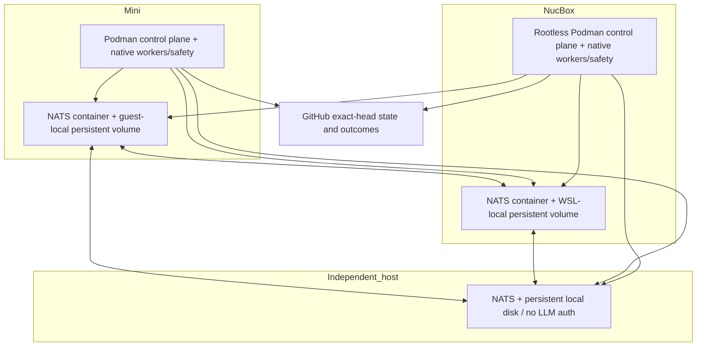

# Shared state, failover, and service packaging

**Status: design only, ready for Jeff's review; implementation remains gated.**
Research date: 2026-10-18 (America/Chicago). Repository inspection baseline:
`8de4571a9ab6285fd95e886d42fcb64568d5914a` (runtime code), with prior design
`5f5bcc240675fb25e5ff3f847ae95bc16117b21c` revised for Jeff's 19:27 container
decision and 19:28 easy-deploy requirement. File references describe that
checkout, not proof of installed behavior on either host. Jeff reports that NATS
runs only on the NucBox today. This research does not claim a live failover test.

Implementation remains behind the ARCHITECTURE QUEUE: first prove at least three
trusted Karen PASSes at their exact installed/reviewed heads and one Karen-gated
automatic merge with no revert. Preserve the queue's stated order A, B, C, D, G,
F, E; G/F may prepare packaging against the existing single authority, but only E
enables replicated state and automatic standby takeover after its fault tests.
This document can be reviewed while the Karen work continues. It does not change
the current Mini lane restrictions, approval rules, or deployment configuration.

## Decision proposed

Use **one three-member NATS JetStream cluster**, with one full storage replica on
the Mini, one on the NucBox, and one on a third independent, always-on host.
Replicate every authoritative stream, KV bucket, object bucket, and durable
consumer three ways. Run the full StoryPool service inventory on both work
machines; elect one active Karen poller, conductor, dispatcher, and combined-health
publisher. Other services have per-node responsibilities. Preserve PR claims in
addition to service leadership. Store durable work records and outcomes centrally;
local files become rebuildable projections, never an alternative write authority.

**Two machines alone cannot deliver the requested safe automatic takeover after
either machine dies.** Two voting members require both votes; one survivor has
no majority. Running three broker processes across two physical hosts merely
chooses which host failure loses the majority. The third member must store data,
including the queue, rather than be a vote-only witness. If Jeff chooses to keep
exactly two storage failure domains, offer safe pause plus explicitly fenced
manual recovery, and describe that limitation in the dashboard. Do not call it
automatic HA. This conclusion follows from JetStream's majority rule. [NATS
cluster topology](https://docs.nats.io/learn/topologies/jetstream-in-a-cluster)

Recommend Jeff's **decided hybrid runtime**: Karen poller, conductor, dispatcher,
dashboard and NATS run in separate Podman containers from one manifest-built OCI
image on both machines. Use Podman machine on the Mini and rootless Podman directly
inside the NucBox's WSL distro. Native launchd/systemd supervise the host guardian,
watchdog, updater, host diagnostics and authenticated CLI task runner. Keep all
Codex/Claude/Cursor workers and their authentication native. Mini VM measurements
are an acceptance gate for sizing, not permission to silently substitute a native
control plane. If the measured budget fails, remain on the existing deployment
and report the blocker. Docker Desktop is an optional friend fallback. Containers
simplify packaging and rollback; they do not supply shared state, quorum or fencing.

## Current state and migration inventory

Paths below use each machine's own home directory. Environment overrides exist;
the future manifest must resolve them explicitly. A file lock or atomic rename
protects one filesystem, not both hosts. Two different queue paths coexist:
control-plane polling/snapshots and the older JetStream mesh queue.

| State / component | Where it lives today; code evidence | Required authority / proposed destination |
| --- | --- | --- |
| Karen verdicts and reviewer evidence | `~/.local/share/karen/verdicts/`; flat `owner_repo_N_sha12_{LATEST,KARENPASS,KARENFAIL}.json` files, full SHA inside; atomic publication and signed delivery. `local_karen/verdict.py`, `verdict_sync.py`, `verdict_push.py`; conductor also reads a legacy nested verdict format. | Immutable signed artifacts in R3 object storage, addressed by full SHA plus review ID and digest; CAS index of the current completed review. Both nodes validate signatures, complete chunk coverage, policy version and exact head. Local verdict files are compatibility caches. |
| Karen poll history/runtime | `~/.local/share/karen/poll_state.json`, `poller-runtime.json`, `poller.log`; configuration supplies the state root. `local_karen/poller.py`, `runtime_status.py`, `config.py`. | Shared scheduling/retry records; local loaded-module fingerprint and provider availability stay node observations. A service leader lease is new work, not an existing capability. |
| Karen/fix/merge work claims | `STORYPOOL_CLAIMS` JetStream KV, configured through `~/.config/storypool/coordination.json` or coordination environment variables; 300-second bucket TTL. `coordination.py`, `coordination_buckets.py`. | Preserve create-only admission and revision-checked renew/release; move backing stream to R3. PR identity intentionally excludes SHA to serialize branch writes across head changes; full SHA stays in the value. |
| Retry and blocked-head policy | Durable `STORYPOOL_CLAIMS_RETRIES` KV, zero TTL, keyed by repo/PR/full SHA; CAS writes under the PR claim. Local `dispatch/blocked-fixes/*.json` and `fix_state/*.json` remain additional views/history. `coordination.py`, `retry_policy.py`, `dispatcher.py`, `fix_dispatcher.py`. | R3 durable retry record plus canonical attempt records. Preserve deterministic blocks until head/policy changes, backoff, attempt caps, and operator escalation across takeover. Reconcile the legacy fix-state path before enabling a second active node. |
| Conductor queue / backlog | Open PRs are fetched from GitHub into in-memory snapshots; `backlog.py` writes `~/.local/share/storypool/backlog.md`; dashboards also consume `backlog.json` when present. Conductor status and daily action logs live under `~/.local/share/storypool/conductor/`. | GitHub remains source for PR heads/CI. Persist admitted tasks, ordering/age, retry time and dispatch intent in shared work records; rebuild display snapshots from those records. A scan result is not itself a durable queue. |
| Mesh queue and results | `setup_streams.py`: file-backed `JOBS` on `jobs.>`, WorkQueue retention, 24-hour max age; `RESULTS` on `results.>`, seven-day max age. Per-node durable consumers `workers_mini`, `workers_nucbox`, `workers_macbook` filter `jobs.n.<node>.>`, with explicit ACK, 30-minute ACK wait and three deliveries. No explicit stream replica count. | R3 streams **and** replicated durable consumer state. Introduce capability-based routing/reassignment so jobs addressed only to a dead node can move. Retain accepted work until a durable terminal outcome; expiration must create a visible blocked/dead-letter record, never silently erase work. |
| Dispatch ledger / worker lifecycle | `~/.local/share/storypool/jobs/ledger.jsonl`, `.ledger.lock`, job logs; local queued/running/done/failed/expired state, PID, outcome SHA and handed-off cluster claim. Local ledger lease expiry is 45 minutes. `job_ledger.py`, `dispatcher.py`, `fix_worker.py`. | Shared durable per-job/PR records and deduplicated transition events. Keep native PID/process-group/unit identity local and qualified by node plus boot ID. A remote PID is not evidence of liveness. Local ledger becomes a projection. |
| Merge safety / rate / broken-main state | `conductor/merge-state.json`: local merge history, pauses and rate state; main-CI reconciliation also queries GitHub. `conductor.py`, `main_ci.py`. | Shared durable merge intents, receipts, rate reservations, repository pauses and CI follow-up deadlines. Never reset these on failover or software rollback. GitHub is the authority for whether a merge occurred. |
| Provider quota / lane capacity | `budget_tracker.py` defaults to `~/.config/storypool/budget_usage.json` and `budget_caps.json`, unless `STORYPOOL_DATA_DIR` overrides; Karen/dashboard also read usage observations such as `codex_weekly_usage.json`. Local guards and lane policy supply capacity. | One shared account-period quota/reservation record and provider stop state, backed by fresh provider evidence. Keep load/swap/disk checks local. A quota estimate cannot substitute for provider-reported weekly usage; missing/stale quota fails closed for new paid work. |
| Maintenance / operator controls | `~/.local/share/storypool/node-control.json`, local lock, confirmed dashboard POSTs and peer proxy; actions appended to `HANDOFF.md`. `node_control.py`, dashboard server. | Shared revisioned desired state, action ID, confirmation/audit receipt, plus per-node observed application. Preserve a local emergency drain latch: a disconnected host can become more restrictive immediately, but cannot clear a shared pause or grant work offline. |
| Dashboard / scorecard / activity | Read-time aggregation of local ledger, verdicts, dispatch/conductor status, metrics, budget files, `MONITOR.md` and peer caches. `dashboard/data_collector.py`, `tachometer.py`; HTTP service on 8790. | Rebuildable local materialized views of canonical events and state; display cluster epoch, authority revision, source timestamp and age. Display counters do not grant permission to merge or spend quota. |
| Health / peer sync / guardian | `machines/<peer>/engine.json`, `sync-status.json`, watchdog logs, `guardian-status.json`, native service state and local HTTP probes. `watchdog.py`, `guardian.py`, `peer_endpoints.py`. | Per-node health reporters publish fresh observations; one elected combined-health publisher produces the shared verdict (queue item C). Both dashboards render that same verdict. Native repair remains independent on each node. |
| Config / deployment / updater | Git checkout, `~/.config/storypool/`, `~/.config/karen/config.json`, live marker, generated plists/user units, machine environment, self-update log. NATS config in `~/.config/bob-cluster/nats.conf`. Current installers are separate scripts/templates. | Item A's versioned, non-secret manifest generates both runtime profiles, ACLs, bucket/stream/consumer declarations, probes and expected inventory. Shared desired version/config hash; each node reports its own applied version and loaded fingerprint. Keys and private overrides remain external. |
| NATS data / membership | `install-nats.sh` defaults JetStream storage to `~/.local/state/bob-cluster/js`; template has no cluster routes or server identity. `nats-up.sh` supervises one server. Installer currently selects a Linux amd64 binary. | Persistent local disk on each of three members, unique stable server identity, one cluster/account/domain and explicit routes; the new image needs Linux arm64 and amd64 NATS binaries. Never share the same live store directory between brokers. |
| Doctor / digests / alerts / logs | Doctor repair task claims are shared; some counters remain local. Conductor digests, root and conductor `NEEDS_JEFF.md`, monitor notes and per-service logs are local. `ops_doctor.py`, `conductor.py`, `service_logging.py`. | Durable deduplicated alert/digest IDs and repair outcomes; markdown files are rendered projections. Local rotated redacted logs remain useful offline; replicate only approved redacted diagnostics/events. No automatic external send is authorized. |

The existing [cluster authority audit](../../cluster/ARCHITECTURE.md) correctly
records several of these gaps. This design supersedes its single-NucBox target
only after the migration gates pass; pointing a Mini client at a new local broker
before forming one authority would recreate split brain.

Repository evidence: [coordination](../../cluster/control_plane/coordination.py),
[bucket registry](../../cluster/coordination_buckets.py),
[ledger](../../cluster/control_plane/job_ledger.py),
[conductor](../../cluster/control_plane/conductor.py),
[mesh declarations](../../cluster/setup_streams.py),
[broker template](../../cluster/nats.conf.template),
[broker installer](../../cluster/install-nats.sh),
[dashboard collector](../../cluster/control_plane/dashboard/data_collector.py),
[budget tracker](../../cluster/control_plane/budget_tracker.py).

### Gaps that must stay visible during migration

The current coordination client accepts one configured server URL, with reconnect
disabled for each short operation; merely starting a second broker leaves that
client path pinned to the NucBox. Migrate every producer, worker, reviewer,
dashboard, doctor and updater client to the same cluster identity and multiple
reachable endpoints, including discovery advertisements that work through the
Mini guest and WSL networking.

The existing retry operation renews the claim and then writes a different KV key.
That is not an atomic lease-and-record transaction. Retry-record CAS rejects an
obsolete record revision; it does not itself prove the separate claim is still
held when the write arrives. Test the pause between those operations. Durable
attempt ownership, retry classification and effect state should share a bounded
resource record where they form one invariant. Do not inherit stronger fencing
claims from the older architecture audit without this proof.

Today's broker template grants the dashboard only live metrics/results subscribe
permissions; reconstructing a shared view needs narrowly generated read/request
permissions and inbox subjects. Its old node-specific job filters, R1 defaults,
local merge-rate counters and local quota estimates are additional cutover
blockers. A second copy of each service alone fixes none of these.

## Storage options

The comparisons are design judgments based on the cited product contracts.
None avoids the need for an independent majority or an external fencing authority
when automatic promotion must survive either of two work hosts disappearing.

| Option | Pros | Cons / impact on StoryPool | Decision |
| --- | --- | --- | --- |
| **NATS JetStream R3: streams + KV + object store** | Reuses current queue, claims, retry client and ACL work; one replication system; watches and replay support views and recovery; artifacts and work notifications can share operations tooling. | Needs a third full storage member. Single-key CAS is not a multi-key transaction; cross-record outbox/reconciliation must be designed. Read caches/watchers are not authority. Blob replication consumes disk/network on every member. | **Recommend**, conditional on third host and race/partition tests. Lowest migration surface. |
| **rqlite, three voting replicas** | SQLite/SQL model suits jobs, retries, receipts, counters and atomic related updates; synchronous consensus; approachable query/debug model. | Rewrite file/KV state access and introduce SQL migrations/client behavior. Still need HA NATS for the existing mesh queue, or replace that queue with a transactional SQL queue/outbox. Adds another distributed system if both remain. No quorum advantage with two hosts. | Best alternative if relational invariants outgrow bounded KV records. |
| **etcd, three members, plus replicated NATS for queue / separate artifact store** | Explicit leases, revisions and transactional comparisons across keys; strong coordination primitives for leadership and quota. | Does not replace durable job delivery or large artifact storage; more daemons, credentials, failure modes and recovery procedures. Migrates working claims while still requiring NATS HA. | Strong coordination option, higher operational cost here. |
| **Single-writer SQLite + Litestream to external object storage** | Simple local SQL, lightweight asynchronous recovery, straightforward historical restores. | Replication lag can lose recent claims/receipts; restore is not safe automatic election. Two independent writers must never publish to the same replica destination. Needs separate fencing/election and still leaves today's NATS queue exposed unless separately addressed. | Suitable for disaster recovery of non-authoritative projections; reject for live claims, quota or merge authority. |

rqlite needs three voters for one-node fault tolerance; non-voting read replicas
do not fix quorum. Its synchronous API must be used for safety state rather than
queued writes; use linearizable reads for admission rather than its default weak
reads. [rqlite clustering](https://rqlite.io/docs/clustering/general-guidelines/),
[rqlite read consistency](https://rqlite.io/docs/api/read-consistency/),
[rqlite queued-write durability](https://rqlite.io/docs/api/queued-writes/)

etcd provides conditional multi-operation transactions and TTL leases; its
coordination advantages are real, but it still pauses without a majority.
[etcd API](https://etcd.io/docs/v3.6/learning/api/),
[etcd failures](https://etcd.io/docs/v3.5/op-guide/failures/)

Litestream describes asynchronous replication and a recent-write loss window;
its own comparison distinguishes disaster recovery from HA.
[Litestream caveats](https://litestream.io/tips/),
[Litestream alternatives](https://litestream.io/alternatives/)

Do not put the live JSONL ledger, SQLite WAL or JetStream directories on an
rsync/Syncthing/shared-home arrangement and call that coordination. This proposal
uses replication protocols and application identities, not filesystem merging.

## Replicated topology and data contracts

The third host must be independent of either machine's power, hypervisor, sleep
and storage. Another VM on the NucBox does not qualify. A separately powered
always-on host or a small remote server is an option for Jeff to select; no
purchase, account creation or provisioning occurs here. Both work hosts may share
a home power/network failure domain: surviving their simultaneous outage is a
separate requirement and is not promised by this R3 layout.

All three members need stable identities, protected route connectivity and the
same account/subject authorization model. Clients receive all server endpoints,
bounded reconnect behavior and TLS verification; a single NucBox URL/proxy/DNS
target must not remain their only path. Routes use the configured cluster port
(conventionally 6222), clients 4222; diagnostics stay loopback-only. Grant only the
required tailnet identities access. Verify direct and DERP-relayed behavior;
an overlay tunnel is not proof of quorum. [Tailscale connection types](https://tailscale.com/docs/reference/connection-types)

Core NATS clustering alone does not replicate stored messages. Existing streams
default to R1 unless explicitly changed. Replicate `JOBS`, `RESULTS`, all `KV_*`
and `OBJ_*` streams and durable consumer state; verify effective placement and
replica health rather than counting connected servers. Mirrors, leaf nodes and
two independent JetStream domains are not substitutes for this one consensus
group. [NATS replication](https://docs.nats.io/learn/clustering/),
[NATS JetStream model](https://docs.nats.io/concepts/jetstream)

Proposed logical stores follow. Names besides the two existing buckets are
design placeholders to be finalized in item A; they are not new resources yet.

| Store | Contents / write contract | Retention and recovery |
| --- | --- | --- |
| `STORYPOOL_LEADERS` KV | Per-service create/CAS lease: node, boot ID, owner UUID, config version, service generation. | Separate short-TTL bucket; never mix expiring leadership with durable outcomes. |
| Existing claims KV | PR/task admission, full SHA and owner; existing create/CAS semantics. | Keep 300-second TTL initially; expiry frees admission, not job history. |
| Durable work KV | One bounded resource record per PR/task, holding current attempt, owner generation, lifecycle, effect intent, outcome and pending event IDs. | No TTL for unresolved work. Terminal archival only after verified export/retention policy; never discard unknown external effects. |
| Existing retry KV | Exact-head attempt limit, reason category and retry-after. | No TTL; head change creates a new policy identity without deleting history. |
| Merge / policy KV | Repository pause, pending main-CI checks, rate reservations, account-period quota and operator desired state. | Durable. Use one CAS record per invariant; reservation recovery is conservative. |
| Verdict index + artifact object bucket | Full-SHA/review-ID/digest index; signed verdict and redacted reviewer evidence as immutable content-addressed objects. | Upload object, verify digest, then CAS index. An interrupted upload leaves an unreferenced object; missing content blocks PASS consumption. |
| Work notification stream | Stable task ID and capability routing hint, durable pull consumers, explicit acknowledgment. | R3; notification ACK only after durable admission/outcome handoff. Canonical work record repairs missing notifications. |
| Audit/event stream | Job transitions, verified merge receipts, controls, quota reservations and alert/digest IDs. | R3; deduplicate by stable domain event ID in reducers, not solely broker duplicate window. Keep sufficient history plus reducer checkpoints to rebuild all displayed periods. |
| Health KV | Each node's boot ID, observation sequence/time, applied config, guards; elected combined verdict with source revisions. | Short observation freshness; durable desired maintenance lives separately. |

Object storage is backed by JetStream and splits objects into chunks. Use it for
redacted completed artifacts, not unlimited logs, raw prompts/diffs or credentials;
object names must be immutable because the store is not an application version
history. [NATS object store](https://docs.nats.io/learn/object-store/)

JetStream KV revisions support conditional updates; its specification warns that
ordinary reads need not provide read-after-write consistency. A stale read may
cause a CAS conflict; it must never authorize a side effect. Every authoritative
transition requires a successful server-acknowledged conditional write. Watches
are refresh hints, not permission. [NATS KV specification](https://github.com/nats-io/nats-architecture-and-design/blob/main/adr/ADR-8.md)

No transaction is assumed across a lease key, job key, quota key, object upload
and event publish. Put ownership generation and lifecycle in the **same durable
resource record** for conditional transitions. Embed pending event/notification
IDs in that record as an outbox; a reconciler republishes until observed. Reserve
quota/rate capacity before admission and retain ambiguous reservations until
reconciled. A crash may temporarily underuse capacity; it must not overspend or
produce two owners. If a necessary invariant cannot fit this model, revisit
rqlite/etcd rather than inventing a transaction from several unchecked writes.

For accepted tasks, require publish acknowledgment before telling a producer its
work is queued. For a publish timeout, retry the same task/event ID and reconcile;
do not create another attempt. Use file storage and a documented disk-sync policy
verified against the selected server version and hardware. R3 protects against a
single member loss; it does not by itself promise survival of correlated power
loss of all disks or replace tested recovery snapshots. [NATS node-loss contract](https://docs.nats.io/learn/jetstream/surviving-node-loss)

## Leadership, fencing and external effects

Every service is installed and supervised on both work hosts. Singleton standby
processes continue reporting readiness and compete only through shared leases.
No process becomes active because peer HTTP failed or a local PID disappeared.

| Service | Both hosts run | Authority / failover behavior |
| --- | --- | --- |
| Karen poller | Scanner/scheduler and standby loop | One service leader admits reviews; each review also takes the PR claim. Native reviewers execute work on eligible nodes. |
| Conductor | Scheduler/merger and standby loop | One leader proposes actions and performs deterministic merge reconciliation; per-PR ownership and durable action intent remain mandatory. |
| Dispatcher | Admission loop and standby loop | One leader allocates jobs; workers on both hosts claim distinct resources with shared quota and local guards. |
| Fix workers | Native supervised worker capability | Active on both eligible hosts for different PRs; no resume of a dead host's process image. |
| Watchdog / guardian | Local probe/repair on each host | Repair only local services; combined health has one separate elected authority. A stale peer never triggers competing remote repairs. |
| Ops doctor | Local findings on each; shared repair capability | Deduplicate paid repair by stable task/branch claim and global budget. |
| Self-update | Native local updater on each | Local transaction under a shared rollout/drain reservation; one machine at a time. Must recover without needing the service/container it updates. |
| Dashboard | Active on each, independently reachable | Read the same shared verdict/state; confirmed POSTs create shared idempotent actions, with pending/applied/failed status. |
| Shadow, digests, monitor, delayed main-CI checks | Install the declared roles on both; keep local observation separate from actions | Shadow is read-only. Digest/date and CI follow-up identities are shared and claimed; monitor repair tasks use the same task/branch ownership rather than launching competing paid work. |
| NATS | Active full member on each, plus third host | Broker leadership is separate from application leadership; losing an app leader must not change broker membership. |

Proposed service lease: 60 seconds, renew every 15 seconds, stop admitting/effecting
work by 30 seconds without a successful renewal. These are targets for experiments,
not changes to the existing 300-second work claim. Poll standbys every 5–10 seconds
with jitter. Client deadlines use monotonic time and conservatively account for
request duration; a slow acknowledgment cannot extend authority beyond the server's
expiry. Clock jumps, suspension and long process pauses must fail closed.

For PR work, retain the current 300-second TTL during initial migration. Existing
code heartbeats at TTL/6 and sets a local deadline at TTL/2; reducing those values
requires separate evidence. A leader handoff does not revoke healthy workers'
PR claims. Renew/release always compare the last revision and owner; an old owner
cannot delete the successor's claim.

An acquisition establishes an immutable generation, distinguished from subsequent
heartbeat revisions. Store the cluster incarnation UUID, acquisition revision,
owner UUID and boot ID with every work attempt. Persist generations in durable
resource records; never derive them from a hostname or wall clock. Restoring a
cluster creates a new incarnation so revisions from a restored older log cannot
validate a stale worker. Rejoining nodes start as standby and discard cached
authority before requesting new claims.

**A lease alone is not a fence for GitHub or a provider API.** A paused process
can wake after expiry, and a network request can finish after ownership is lost.
Shared-state CAS rejects stale resource transitions only when the ownership and
transition are checked atomically. Native runners must stop subprocess groups on
lease loss and require a fresh conditional transition before each commit, push,
review publication or merge. They accept bounded typed tasks, not arbitrary shell
commands from a dashboard/container. [etcd's discussion of lock limitations](https://etcd.io/docs/v3.5/learning/why/)

For merges, persist a unique repo/PR/full-SHA merge intent before the request,
including review digest, policy/config version, rate reservation and CI evidence.
Re-fetch live head, draft status, CI and mergeability under ownership; require
two independent exact-head Karen PASS votes, complete chunks, never-touch
exclusion, and no repository/global pause. Send the SHA-pinned merge request.
GitHub CLI's `--match-head-commit` checks the PR head; it does **not** understand a
StoryPool fencing generation. [GitHub CLI merge contract](https://cli.github.com/manual/gh_pr_merge)

On timeout or crash after submission, mark the effect **unknown**, query GitHub
for merged state/merge commit and reconcile that same intent. Never spend a new
rate slot or initiate a new logical merge merely because a local receipt is
missing. A PR can have one successful GitHub merge, but no distributed lease can
promise exactly one HTTP request across that crash window. The invariant is one
logical merge and one verified receipt. If head/evidence cannot be reconciled,
pause that PR and escalate. Follow main CI within the existing 15-minute target;
red main opens one deduplicated revert PR and pauses the repository. No direct
push to main, automatic release/tag or bypass of Karen is introduced.

For arbitrary remote effects, strict rejection of every request after lease expiry
requires the destination to enforce a generation or conditional operation. Neither
a heartbeat thread nor a check immediately before a CLI call closes the pause
between that check and the remote request. Resource-record CAS fences an old
generation **after a successor has conditionally installed its generation in that
same record**. It does not atomically validate another lease key, or make GitHub
reject a generation. A successor must complete that takeover CAS before doing
work; heartbeats cannot restore the old generation. Native runner checks and
process cancellation reduce the remaining window, not eliminate it. Failover tests
must distinguish stale record rejection from remote requests already in flight.

For branch publication, use the remote's ordinary fast-forward protection and
verify the resulting full SHA. A duplicate worker based on an obsolete head must
not be allowed to overwrite an advanced branch. Do not introduce force-push or
force-with-lease under this design. If an operation needs a stronger expected-ref
contract than the permitted Git operation provides, stop and revise that operation
before enabling failover. An external effect without a usable conditional or
idempotency contract stays blocked on ambiguity; automatic retry cannot manufacture
that guarantee. Proving these contracts is an implementation gate.

Do not start a fresh logical review merely because leadership changed: first
consult the shared full-SHA/policy/coverage index and existing attempt. Persist
completed independent votes once and distinguish explicit re-review IDs from
redelivery. The one scheduler owns task ordering; dispatchers execute admitted
plans and native runners never invent an alternate queue.

The same limitation applies to paid model calls: a provider may complete a call
whose response was lost. Reuse a provider idempotency key where supported; persist
completed chunk/vote artifacts; otherwise retain an unknown attempt and budget
reservation before any controlled retry. Promise no overlapping authorized review
attempts and no stale verdict publication, not mathematically exactly-once billing.

## Failure behavior and recovery targets

Targets below are proposed acceptance criteria under a healthy surviving quorum,
working storage, tailnet connectivity and the pinned tested runtime. They are not
measurements of today's deployment. Record p50/p95 and worst case in drills.

| Event / objective | Target / behavior |
| --- | --- |
| Single broker loss, including NucBox | Publish/claim availability restored within 30 seconds at p95; zero loss of acknowledged authoritative writes for this single-member failure model. All R3 peers/consumer positions verified. |
| Singleton application leader crash | Standby active within 120 seconds at p95, including lease expiry, reconnect and scheduling; no simultaneous valid generations. |
| Machine death with in-flight PR work | Mark node stale within 60 seconds; recover eligible abandoned attempts within 360 seconds after last valid claim renewal (300-second TTL plus reconciliation allowance). Long-running work execution time is additional. |
| Loss of claim/quorum | Stop new paid work, writes and merge authorization immediately on failed admission/renewal; suspended owners are fenced on resumption before effects. Never wait for a dashboard timeout to make this decision. |
| Health observations | Report every 15 seconds; classify stale after 45 seconds, unreachable/unknown after 60 seconds; combined verdict refreshed at least every 15 seconds. Desired maintenance is persistent and distinct from telemetry freshness. |
| Dashboard takeover | Alternate per-node endpoint usable within 120 seconds; display age and authority immediately. Transparent failover at one URL needs independently HA ingress and is not supplied by two Tailscale Serve endpoints alone. |
| Rejoin | Catch up, verify config and signatures, and pass probes before eligibility; target readiness within five minutes for the bounded test dataset. Larger replay has an explicit measured budget. No forced takeover or automatic failback. |

| Partition / failure | Permitted result |
| --- | --- |
| Mini lost; NucBox and third member connected | Majority serves; NucBox takes any singleton roles and eligible work. |
| NucBox lost; Mini and third member connected | Majority serves; Mini takes roles within its guards and available credentials. Throughput can fall; safe takeover does not mean equal capacity. |
| Third member lost; Mini and NucBox connected | Work continues on two voters, cluster marked degraded; do not roll/restart another member. |
| Mini isolated from NucBox, both connected to third member | Consensus still arbitrates through the reachable cluster; one owner per lease/resource. Direct peer HTTP failure alone does not elect leaders. |
| One host isolated from the other two | Only majority side admits work; isolated host drains/fences, serves stale read-only views with warnings. |
| No connected majority, tailnet-wide interruption, or two members lost | All new authoritative work pauses. Local health/guardian and emergency stop remain available; cached PASS or queued work cannot authorize effects. |
| GitHub unavailable but NATS healthy | Health can operate; merges/push-dependent outcome verification pause. Keep unknown receipts; do not declare success from a process exit. |

Tailscale can use direct or relayed paths, and latency/path changes can affect lease
renewal. Test loss, asymmetry and blackholes, not just stopping the tailnet client.
Reconnection never merges two writable histories. A recovered node follows the
existing cluster; automatic force-new-cluster or quorum reduction is forbidden.

## What happens to in-flight jobs

1. **Queued, never started:** shared work record survives; delivery moves to a
   capable healthy node. Migration must remove the current dead-node subject trap.
2. **Claimed but worker not started:** reconciler checks durable attempt and node
   boot/liveness after expiry; reserves a successor generation. Local ledger's
   45-minute expiry must not set the new failover delay.
3. **Worker running on healthy node, scheduler dies:** worker retains its own
   claim/heartbeat and can finish; new scheduler adopts observation, not ownership.
4. **Worker host dies or loses quorum:** process work is not migrated. Old owner
   cannot publish after lease loss; successor checks the remote PR head, pushes,
   completed tests/review artifacts and any unknown effect before retrying. An
   unpushed worktree may be lost and recomputed; it is not authoritative state.
5. **Push/merge accepted, receipt lost:** query remote outcome and attach it to
   the existing intent. Head changed without a matching receipt means reconcile
   and re-review; never reuse a PASS from the previous SHA.
6. **Review interrupted:** retain valid signed completed chunks/votes tied to full
   SHA, coverage manifest, reviewer and policy version; rerun missing/unknown work
   under budget. ERROR remains retryable ERROR, never an invented FAIL or PASS.
7. **Redelivery after outcome:** read/conditionally validate terminal work record
   and acknowledge without launching a second worker. ACK loss can redeliver; the
   broker is not the deduplication authority for GitHub effects.

Explicit ACK consumers and redelivery are useful primitives, not a promise that
application side effects run once. Long work needs progress signaling and bounded
redelivery/backoff; exhausted attempts go to visible dead-letter reconciliation.
[NATS consumer behavior](https://docs.nats.io/learn/jetstream/pull-consumers)

## Credentials and private data

Provision credentials independently on each eligible machine: native
Codex/Claude/Cursor login state, local provider key files, GitHub identity, distinct
NATS service/node identities and verdict signing identity. **Never replicate
secrets in plaintext** through KV, object storage, events, logs, markdown, image
layers, build arguments, registry metadata, manifests or snapshots. Never copy
CLI auth directories into or mount them inside OCI images. Images and the third
broker contain no LLM worker auth.

The manifest names secret references and required capabilities, never values.
Use macOS Keychain or restricted machine-local files and Linux protected
credentials; inject only a service's required secret through a read-only runtime
mount or protected descriptor/file. Encrypted secret distribution, if adopted later,
needs per-machine recipient keys and separate approval/provisioning; shared state
does not become a secret distribution channel. TLS/tailnet transport encryption
and disk encryption do not excuse storing plaintext secret payloads in NATS.
[NATS transport/storage encryption](https://docs.nats.io/learn/security/encryption)

Prefer separate NATS public-key identities for each node/service: brokers can
share public NKeys and permissions while each private client seed stays on its
machine. Broker TLS private keys are also node-specific. This avoids copying
current password-bearing generated configs to the new broker hosts. Provision
and rotate private material outside the shared state/image pipeline, and prove
revocation on all reachable brokers. [NATS public-key authentication](https://docs.nats.io/learn/security/authentication-basics)

Use separate signing keys with trusted public identities on both hosts, not a
shared private signing file. Validate origin, full SHA, digest, review policy,
timestamp and replay identity on shared verdict reads. Preserve historical public
keys for verification. Missing second-machine credentials mark the capability
unavailable and pause affected work; a standby is not failover-ready simply
because its process is running. Never log raw diff, provider reply or credential
values while collecting drill evidence.

Do not mistake a runtime secret mechanism for encrypted distribution: Podman
supports secret mounts and defaults to its file driver; that is not a promise of
encrypted storage. Verify the pinned driver's protection and use an appropriately
protected per-machine credential source; audit guest
backups/disk images and runtime stores as sensitive when they contain service
credentials. Avoid persistent guest copies where an ephemeral mount can serve the
same need, and exclude private credential sources from shared application exports.
[Podman secret storage](https://docs.podman.io/en/latest/markdown/podman-secret-create.1.html)

## Containers versus native supervision

Jeff decided item F at 19:27: **hybrid on both machines**. The comparisons below
explain that choice and its costs. They do not reopen it or recommend leaving
NATS/the Mini control plane native by default. Item G adds a one-command install,
upgrade and uninstall experience; both items wait for the Karen proof gate.

### One manifest, one image, separate services

Item A describes service identity, command/role, platform support, local
dependencies, schedules, singleton key, bucket/subject access, resources, probes,
drain behavior, secret references and state schema once. Generate native host
launchd/systemd definitions, guest/rootless Quadlets, non-secret runtime configs,
NATS ACLs and bucket/stream/consumer declarations from that same manifest. Preflight
must reject omitted services, drifted hashes, missing ACL subjects/buckets, wrong
replica counts, incompatible schemas and absent local capabilities. A manifest
hash alone does not prove the effective generated config matches its semantics.

Build **one versioned multi-architecture StoryPool control-plane image** containing
the locked application dependencies and a pinned, checksum-verified `nats-server`
binary. Run five separate service containers from its same platform digest: Karen
poller, conductor, dispatcher, dashboard and NATS, with role-specific commands and
permissions. One image does not mean one process supervising all five. Keep NATS
version/compatibility metadata separately visible even though it shares the image;
a code update need not restart an unchanged broker. This follows Jeff's one-image
requirement rather than introducing an independent floating upstream NATS image.

Produce `linux/amd64` and `linux/arm64` images under one OCI image index, recording
the source, manifest, schema and per-platform digests in release metadata. Both
nodes use one logical release; their platform digests differ. An image index is
not a macOS executable. Build away from the Mini; scan image contents, dependency
inventory and provenance before promotion. No image, Containerfile or pipeline is
created by this research.

| Packaging choice | Advantages | Costs / limitations | Assessment |
| --- | --- | --- | --- |
| Native launchd/systemd for every service | Avoids a Linux guest on Mini; direct host metrics, CLI and Keychain integration; uses today's supervision. | Python/CLI/library drift; platform-specific update and reload behavior; friend setup and rollback need native bundles and extensive OS checks. | Useful baseline and emergency compatible rollback; not the decided F target. |
| Put every service and authenticated worker in containers | Common Linux userspace and dependency packaging; resource limits and image rollback. | macOS guest and storage/network lifecycle; broad host mounts defeat isolation; CLI login/browser/keychain flows become harder. Moving worker auth violates Jeff's boundary. | Reject the all-container worker model. |
| **Hybrid: OCI control plane, native workers and safety** | Identical schedulers/dashboard/broker release on both hosts; immutable payload and repeatable friend installs; authenticated CLIs keep their supported host environment. | Native runner protocol plus guest/WSL lifecycle must be maintained; guest loss removes five local services; image rollback still cannot undo incompatible state. | **Recommend and implement F after its gate.** |

| Service / capability | Mini | NucBox | Failure responsibility |
| --- | --- | --- | --- |
| Karen poller, conductor, dispatcher | Separate containers inside Podman machine | Separate rootless containers in existing WSL distro | Shared leader/PR claims; native task runner handles CLI work. |
| Dashboard | Container, published to host loopback; existing tailnet HTTPS path | Rootless container, same approved access policy | Both serve shared projections and label stale data. No broad public bind. |
| NATS | Container with dedicated guest-local persistent volume | Container with dedicated WSL Linux-filesystem volume | One member per machine, plus independent third storage member; R3/quorum still mandatory. |
| Codex/Claude/Cursor reviewers, fix workers, authenticated provider CLI calls | Native macOS supervised processes | Native Linux processes/transient user units inside WSL | Native CLI auth never enters images or container mounts; claim-aware execution and guard enforcement. |
| Watchdog, guardian, updater, host metrics and local emergency drain | Native launchd | Native systemd user services | Recover Podman/guest failures from outside the guest and keep local safety available without NATS. |
| Ops doctor | Native local diagnostics/repair runner; optional container planning uses typed tasks | Same | Repair tasks take shared claims; local findings remain possible offline. |
| Third NATS member | Independent host, preferably same verified image if Linux | Not another process on either work machine | Its credentials, disk and runtime are independent of both work hosts. |

Podman needs a Linux VM on macOS. NucBox rootless Podman runs directly in its
existing WSL Linux environment, avoiding another nested Podman VM. Quadlet provides
systemd container supervision on Linux and inside the Mini guest; host launchd
still owns guest startup/recovery. [Podman machine](https://docs.podman.io/en/stable/markdown/podman-machine.1.html),
[Podman installation](https://podman.io/docs/installation),
[Podman Quadlet](https://docs.podman.io/en/latest/markdown/podman-systemd.unit.5.html)

WSL's systemd support alone does not keep the distro alive. Verify the approved
Windows startup/lifecycle mechanism, WSL shutdown/restart, user-session boot,
systemd availability, rootless cgroups/user mappings and tailnet reachability as
installation prerequisites. Requests needing Windows admin or sudo remain visible
user actions; the join command must not silently elevate. Do not treat a successful
interactive `podman run` as proof of unattended recovery. [Microsoft WSL systemd](https://learn.microsoft.com/en-us/windows/wsl/systemd),
[WSL configuration](https://learn.microsoft.com/en-us/windows/wsl/wsl-config)

### Native task and network boundaries

Karen currently invokes reviewers, and conductor/doctor can invoke provider tools.
Separate scheduling from a **native local task runner** before moving those
schedulers into containers. It accepts bounded typed tasks carrying task ID,
resource generation, pinned SHA, policy version and deadline; checks the shared
claim, never-touch rules, quotas and local guards itself; and returns redacted,
signed evidence. It owns the installed CLI executable, native process supervision
and authentication. Do not give a container the whole home directory, Docker/Podman
socket, SSH agent, CLI auth directories or an arbitrary shell-execution RPC.

Across the Mini guest/host boundary, use a small authenticated transport (for
example, a host-only endpoint with mutually authenticated clients), scoped to
this task schema. Do not assume a Unix socket on the host is automatically a safe
or portable VM interface. Native runner and control-plane protocol versions must
be included in the same release compatibility check. The dashboard reads canonical
shared projections and narrow host-health/control APIs rather than arbitrary home
files. Per-machine service secrets mount read-only for only their consumer;
Codex/Claude/Cursor auth remains exclusively in the native runner's host context.

Networking is part of preflight. Guest private addresses and WSL NAT addresses
must not be advertised as cluster/client endpoints to the peer. Use stable host
Tailscale names/addresses with explicit tested forwarding to the broker's client
and route ports, and configure NATS client and route advertisements accordingly.
Prefer host-loopback container publishes behind narrowly scoped tailnet ingress;
if the selected Podman backend cannot provide that path, stop deployment until a
bounded host forwarding adapter is tested. No public wildcard exposure as a fix.
Application clients receive every member endpoint. NATS diagnostics stay private.
Test DNS changes, macOS sleep/wake, WSL restart, route reconnect and DERP paths.

Keep JetStream hot data in Linux-native persistent volumes, including inside the
Mini guest, rather than shared macOS-home/Windows-directory mounts. Volumes survive
container replacement and image rollback; a guest/disk loss counts as losing one
replica. Storage, UID mappings, bind addresses and secret mounts are explicit
manifest outputs. Run as non-root, read-only image root filesystem where supported,
with bounded temporary space and only the required writable data volumes. Rootless
is an isolation improvement, not proof that a compromised app cannot access its
own granted service credential.

### Mini VM tradeoffs, costs and guards

No reliable hardware/RAM/idle-cost measurement for the Mini was taken in this
research. Vendor efficiency claims do not establish StoryPool capacity. Measure
on the installed macOS/hardware before setting the production guest budget.

| macOS runtime | Documented behavior | Cost and decision |
| --- | --- | --- |
| **Podman machine** | Linux guest; CPU, memory and disk budgets are configurable; supported host/guest Podman versions must match. | Guest RAM/CPU, OS maintenance, disk image/image cache, forwarding and boot recovery. **Default per F**, with pinned backend/version and measured acceptance. |
| OrbStack | Resource controls include total memory and CPU; unused memory is released. Its licensing distinguishes personal from professional/commercial use. | Could improve convenience or observed idle behavior; needs separate benchmarks, compatibility adapter and any applicable license. Optional evaluated alternative, not a silent Podman replacement. |
| Apple `container` | OCI-compatible Linux containers in lightweight VMs; upstream requires Apple silicon and supports macOS 26. | Separate container VMs change memory/network/supervision costs; verify Mini OS/CPU first. Does not provide Podman machine/Quadlet equivalence. Evaluate later, not default F implementation. |
| Docker Desktop | Optional friend compatibility profile. | Adds another runtime/VM and lifecycle adapter; must pass the same state/auth/guard tests. Do not install it as the default or run two VM runtimes for StoryPool. |

[Podman guest resources/versions](https://docs.podman.io/en/stable/markdown/podman-machine-init.1.html),
[OrbStack resource settings](https://docs.orbstack.dev/settings),
[OrbStack licensing policy](https://docs.orbstack.dev/licensing),
[Apple container requirements](https://github.com/apple/container),
[Apple containerization architecture](https://github.com/apple/containerization)

Start the isolated sizing trial with **2 vCPU, 2 GiB guest RAM and a 16 GiB virtual
disk ceiling**, subject to actual preflight headroom. These are experiment budgets,
not a claim that all services fit. Budget guest OS, the current and previous image,
stream/object/consumer replicas, bounded logs, unpack space and catch-up; the
virtual-disk ceiling does not reserve physical free disk. Measure idle, normal
review/dispatch, queue replay, image pull/unpack, update and peer takeover. Record
host/guest RSS and CPU, memory pressure, physical disk high-water, swap trend,
energy and p50/p95 service/claim latency. Use native arm64 images on Apple silicon;
amd64 emulation is not the capacity baseline.

The Mini guards remain load <10, swap <80%, disk >=15 GB. Include guest and image
cache usage in **host** accounting; guest-free RAM cannot establish host safety.
Propose at least 2 GiB available host memory after warmup and no sustained upward
swap trend as additional trial acceptance margins. Calibrate them against the
native baseline and failover load. Keep NucBox within seven lanes with two reserved
for Codex, and enforce the one shared 75% weekly quota stop independently of VM
headroom. Build images elsewhere and schedule pulls away from resource peaks.

On breach, drain/reduce native worker lanes and suspend nonessential pulls/builds;
preserve NATS/host safety first. If the bounded VM cannot sustain the five services,
keep the current deployment and report a measured blocker rather than raising
memory into the swap guard. Single-survivor acceptance must include all singleton
roles and a reduced but working native-worker capacity. Equal throughput is not
required for safe failover.

Costs include one guest OS on the Mini, image cache plus rollback artifact,
persistent disk on all three replicas, replication bandwidth, third-host hosting
and runtime operations. No specific dollar estimate is defensible without the
selected third host, measured retention/traffic and a licensing profile. No host,
license or account is purchased by this design.

### Image updates, rollback and friends

Item B's release descriptor ties source/manifest/schema and native-runner protocol
to immutable image digests and native host-agent bundle hashes. Jeff stays edge;
friends default stable. Promotion requires tests, exact-head Karen and one-machine
canary. A convenient version tag selects a verified descriptor; execution pins its
digest. Tag movement alone does not authorize an update. No tag or release is cut
without Jeff's OK.

The native updater verifies artifact identity and compatibility, prefetches within
disk guards, drains one node, hands off leadership, waits for running native tasks
or records controlled requeue, then replaces that node's service containers. Update
NATS only through a version-compatible, one-member-at-a-time procedure after all
other replicas are current. Never roll both work machines or two quorum members
together. Keep the previous verified digest and native bundle cached so registry
outage cannot prevent rollback. Mounted keys, local overrides and persistent
volumes live outside the image and survive the switch.

Readiness checks cover the effective loaded digest/manifest, listener ownership,
HTTP, quorum/replication, a CAS claim round trip, native-runner compatibility and
fresh health authority. Observe actual scheduler outcomes during a bounded canary;
a green container process alone is insufficient. On candidate failure, drain it,
fence/reconcile pending effects, restart the previous compatible digest, verify
health, then resume. If neither version is healthy, remain drained and report the
failed steps. Do not reset data/counters or repeatedly bounce the cluster.

Podman auto-update can roll back when its systemd restart fails, and its docs
explain why readiness notification matters. It does not supply this multi-service
canary policy or reverse state migrations. Use a channel controller rather than
unconditional mutable-tag auto-update. [Podman rollback contract](https://docs.podman.io/en/latest/markdown/podman-auto-update.1.html)

Item G's intended interface is one `storypool join`/installer command that also
upgrades an existing machine. It detects macOS/Linux/WSL and architecture,
installs missing Podman only with any required sudo/admin confirmation, prompts
for a short-lived one-use join token and the few selected key/capability references,
verifies the release, runs preflight, starts the generated inventory and performs
health/claim checks. It reports a ready node or a clear drained/blocking reason,
never success with missing services. No manual config edits. First-join tokens
are private input, omitted from shell history/logs and never included in shared
state; exchange them for node-specific limited identities.

Friends join initially as workers/standbys, not automatic JetStream voters. Adding
a friend must not silently change quorum, copy Jeff's provider identity or grant
merge authority. A participant lacking local CLI login may join as a restricted
capability; the command explains which worker capabilities still need native login.
Time the target **under ten minutes from a clean supported OS to healthy joined
node**, recording download speed, package-manager/admin prompts and any reboot.
A required reboot or unavailable credential is an explicit failed target/blocker,
not hidden from the measurement. Keep the README short with install, status,
upgrade, rollback and uninstall examples.

`storypool uninstall` must drain/reconcile work, revoke the node identity, remove
only StoryPool-generated services/forwarding and its owned containers/artifacts,
and offer explicit removal/export of StoryPool-owned data and secrets. Refuse an
uninstall that would remove a needed voting member until membership is safely
changed and replicas are current; never leave an abandoned node credential. Do
not delete a friend's unrelated Podman machine, other images or CLI login/config.
The acceptance drill proves both complete StoryPool removal and unrelated-tool
preservation. This is an interface design, not an implemented command.

### Current Mini reload failure: required regression scenario

The reported 8790 bind race remains an **active core repair outside this design**.
Code inspection confirms `install-all-mini.sh` uses `set -euo pipefail`, delegates
reload to guardian, and `reinstall()` captures installer stdout/stderr but returns
only a Boolean. This explains how one failed dashboard reload can hide its reason
and prevent later poller deployment; no live fix is claimed here.

Both native and container installers need a bounded sequence: request old-service
stop; wait for its supervisor/process and listener to release; start the candidate;
retry transient bind/readiness failures with backoff; verify its loaded version.
`SO_REUSEADDR` may help TCP reuse but does not replace waiting for a still-live
listener or validating which process owns the port. A regression must hold the
old listener past stop, then release it, and distinguish successful delayed startup
from a permanently occupied port. Verify both outcomes within deadlines.

Independent later install steps should still run after a component failure, with
per-step results and a nonzero aggregate result; prerequisite-dependent steps stay
blocked explicitly. Save redacted installer stdout/stderr, timeout/failure context
and the final report in `self-update.log`. Test that Karen's independent redeploy
is attempted after a dashboard failure and that a secret-like diagnostic is
redacted. Port ownership and detailed output stay acceptance criteria even after
image packaging; containers alone do not fix the race.

## Staged migration and rollback

Every stage below is future implementation. Preserve before/after snapshots and
test evidence; no stage grants permission to skip earlier architecture items.

| Stage | Entry / work / exit evidence | Rollback boundary |
| --- | --- | --- |
| 0 — Review only, now | Inventory, sourced comparison and fault plan. Karen proof is not established by this document. Jeff reviews the third storage failure domain; hybrid F is already decided. | Revise documentation only; zero runtime impact. |
| 1 — Gate and A–D | Prove three exact-head PASSes and one unreverted gated automatic merge. Implement/test manifest/preflight, release-channel design/code, one health authority and smaller attributable changes in order. No release cutting without Jeff. | Revert each compatible change; retain the existing single authority and Mini lane restrictions. |
| 2 — G: easy-deploy preparation | Build join/upgrade/uninstall against an isolated inventory and the existing single authority. Test clean Linux VM/WSL/macOS profiles, no manual edits, bounded privilege prompts and under-ten-minute target. Final OCI profile acceptance repeats in F. Friends remain non-voting, with explicit capabilities. | Remove generated test resources/revoke test identities; production stays unchanged. |
| 3 — F: hybrid packaging | Separate and test native runner; build one multi-architecture image; canary all five roles on NucBox, then bounded Mini Podman machine. Both install full inventory but keep current single-admitter policy; no E failover claim. Transfer the existing broker store offline into its owned volume through a tested version-compatible procedure; never two processes opening it. Prove port handoff, reboot, auth isolation and compatible image rollback. | Drain one node; return to prior verified digest or compatible native bundle with the current data. Before production writes on the new broker version, validate its reverse-compatibility or prohibit broker binary downgrade. Never replace a live store with a stale copy. |
| 4 — E: storage preparation | Select/provision independent third storage host privately; pin tested server/client versions. Prove isolated R3 topology, endpoint forwarding and multi-endpoint clients. Take secret-free application exports and broker-supported snapshots; baseline stream counts/digests, retry blocks, merge/CI state, pauses and quotas. | Discard isolated test cluster without touching production identity; current single authority remains. |
| 5 — E: one replicated broker authority | Controlled admission pause; drain/reconcile old attempts and unknown effects. Join Mini and third broker through a rehearsed supported membership path; convert every authoritative backing stream and durable consumer to R3. Verify all peers current, placement and accepted-message inventory before resuming the existing single scheduler. No independently writable fallback cluster. | Before resume, use rehearsed offline restoration if needed. After resume, preserve every accepted R3 write; use compatible application rollback or remain paused. Never force quorum down to one to make rollback work. |
| 6 — E: durable application state | Import signed artifacts, ledger/attempt identities, retries, merge receipts/limits/CI pauses, quota and maintenance. Resolve contradictory imports by GitHub/signatures/provenance, not file mtime. Shadow shared readers; briefly quiesce each resource class and switch to one shared writer. Local outputs become projections. | Before cutover stop shadow reads. After cutover roll back only to a shared-authority-compatible reader/writer; stale local ledgers/counters never regain authority. |
| 7 — E: standby activation | Both hosts prove credentials/capabilities, loaded digest/config and guard headroom. Enable lease competition one singleton at a time; enable distinct-PR workers only after shared quota/claim and duplicate-work prerequisites. No forced automatic failback. | Drain/fence standby and elect one leader through the same shared authority; retain receipts/retries/pauses and replication. |
| 8 — E: failover proof | Run the matrix below in both directions, then at least a 24h duplicate audit and normal outcome verification. Prove fresh health, queue survival, no stale verdict publication, one logical merge/receipt and resource guards. Repeat friend install/rollback with final profile. | Shared pause on safety violation, fence owners, reconcile GitHub, restore last compatible image/native agents. Retain replicated state; a rollback is not permission to erase accepted work. |

Schema changes use expand/contract: new readers accept the prior schema, writers
are gated on compatible participants, and destructive cleanup waits through the
rollback window. A known-good image cannot safely roll back an incompatible data
migration. For irrecoverable quorum/disk loss, globally pause and fence all old
members, choose a verified snapshot plus event tail, reconcile external GitHub
outcomes, establish a **new cluster incarnation**, and reissue authority only after
validation. That is manual disaster recovery with explicit RPO, not ordinary HA.

Do not reclaim leaked quota/merge reservations, clear retry blocks or rebuild
merge counts from an empty file just to make a rollout green. Conflicts/import
errors fail closed with redacted evidence and an actionable review item.

## Verification plan and review evidence

Use an isolated three-member test cluster first. Real host drills occur only after
the queue gate and implementation checks, with a documented recovery path. Never
partition the production tailnet during this research. Freeze the test version and
manifest; sanitize evidence before committing it to this public repository.

| Scenario | Injection and required evidence |
| --- | --- |
| Kill leader process | Kill each singleton leader after lease renewal and before/after admission. Record old/new generation and timeline; standby takes over <=120s p95, one owner per resource, no duplicate logical job/review/merge. Repeat with a paused process resumed after TTL. |
| Kill either whole machine | Separately stop Mini and NucBox, including their brokers, while tasks are queued and working. Confirm surviving host plus third voter writes/reads and drains queue, no accepted-task loss, and <=360s orphan eligibility. Repeat with each broker hosting meta/stream/consumer leadership. |
| Queue survives either host | Enqueue uniquely identified tasks and record publish ACKs; kill NucBox; verify Mini consumes all accepted tasks and records one outcome each. Repeat with Mini killed and NucBox consuming. Include tasks formerly pinned to the dead node and ACK-lost redelivery. Broker presence alone is not a pass. |
| Third node failure / quorum loss | Lose third member alone: continue degraded. Then lose either remaining member: no admission, paid work or merge authorization. Recover without force-new-cluster. |
| Partition and asymmetric path | Isolate one host from both peers, block client port separately from route port, allow only one-way traffic, add latency/loss and switch direct/DERP paths. Majority continues; isolated native runner fences even if GitHub stays reachable. Test both work hosts as isolated member. |
| No majority | Split all three, including stale watch/cache reads and pending ACKs. Confirm no local fallback, no promotion from HTTP health, and clear read-only/stale UI. |
| Rejoin and stale owner | Resume old leader with cached PASS, saved claim and buffered subprocess/request. Its CAS/write/release is rejected; it cannot delete successor state. It catches up as standby and runs only after fresh capability/config checks. |
| Merge crash windows | Crash before intent, after intent, after GitHub accepts but before receipt, and after receipt before ACK. Verify one GitHub merge, one receipt/rate count and one main-CI follow-up/revert intent. Recheck changed SHA, draft, red/missing CI, missing reviewer/chunk and never-touch rejection. |
| Review crash windows | Lose a reviewer mid-chunk/provider response; prove ERROR/backoff, retained valid evidence, exact-head validation, no stale publication and no retry beyond quota. Exercise a missing standby signing/provider key. |
| Outbox and storage faults | Crash between record CAS and event publish, between artifact upload and index, and during projection update; redeliver after broker dedup window. Recover identical views without another worker/effect. Reject disk-full/replica-unavailable writes; accepted receipt must not be guessed. |
| Lease / clock / restore | Inject long process pause, delayed ACK, clock step and host suspend. Monotonic deadlines stop effects; restored old generation is rejected by new incarnation. Exercise TTL deletion lag rather than assuming exact expiry. |
| Shared counters / controls | Race two allocators for one quota unit and merge slot; preserve the 75% weekly stop. Race confirmed actions with same ID; one audit/action. Offline drain works, offline resume fails closed; maintenance survives reboot and failover. |
| Health and dashboard | Kill combined-health leader and one dashboard independently. Both views show the same fresh authority or explicit stale state; two per-node URLs remain documented. Stale peer data is never current, and maintenance never causes watchdog repair. |
| Native / OCI update rollback | Verify profile parity, image architecture/digest, credentials absent from image/build/logs, guest crash recovery by native guardian, previous-port shutdown before new bind, failed installer step visibility and later independent steps, compatible schema rollback and preserved keys/config. Refuse rollback across incompatible NATS storage versions. |
| Friend install / upgrade / uninstall | From a clean supported Linux VM, WSL distro and macOS host, time join to healthy under ten minutes; record prompts, reboot and downloads. Upgrade with one bad digest/health check, prove automatic compatible rollback; uninstall only owned resources and revoke credentials. Joining a worker never changes broker voting membership. |
| Capacity under takeover | Run at existing guards, then fail a node while pulling/updating/replaying. No Mini load/swap/disk breach; lane count falls before safety plane is starved. Compare native and guest benchmarks with fixed workload. |

For each drill retain: source/full SHA and loaded fingerprints on both machines,
manifest hash, effective replica placement, redacted timeline with CT and monotonic
durations, task/review/intent/event IDs, claim generations, ACK/outcome comparison,
GitHub merge evidence, recovery duration and expected-versus-observed result.
Gather a baseline before injection and a final reconciliation after rejoin.
Assertions should count authoritative identities rather than repeated log lines.

Release acceptance requires zero duplicated logical outcomes, rejection of stale
shared-state transitions, no new effects authorized after ownership loss, and
reconciliation of already submitted unknown effects. Require zero loss of
acknowledged safety state in the
single-member-loss tests, and all existing safety/regression suites passing on
native macOS/Python 3.9, Linux/Python 3.14 and both pinned Linux image architectures. External unknown-effect handling
must be demonstrated rather than claimed away. Production evidence still needs
the separate 24-hour duplicate audit and Jeff's six-hour STABLE criteria; unit
tests, connected brokers and this design do not establish those outcomes.

## Decisions for Jeff's review

The remaining infrastructure decision is the independent third full-storage host:
its failure domain, access and cost. Review the proposed R3 NATS choice and
resource budgets. F's hybrid placement is already decided: Podman control-plane
containers on both, native authenticated workers/safety, optional Docker Desktop
fallback for friends. No repeat approval for that placement is requested here.
If a third failure domain is unavailable, accept safe pause plus manually fenced
recovery instead of claiming automatic two-host HA. Implementation stays behind
the Karen proof gate and the queue's A, B, C, D, G, F, E order. Cutting a tag/release
remains a separate Jeff decision under B.

Sources linked next to claims are primary project/vendor documentation, retrieved
2026-10-18. Storage tradeoffs, sizing budgets, recovery times and migration
sequencing are StoryPool design judgments, not vendor guarantees or measured
production results. Recheck version-specific behavior when pinning implementation.
