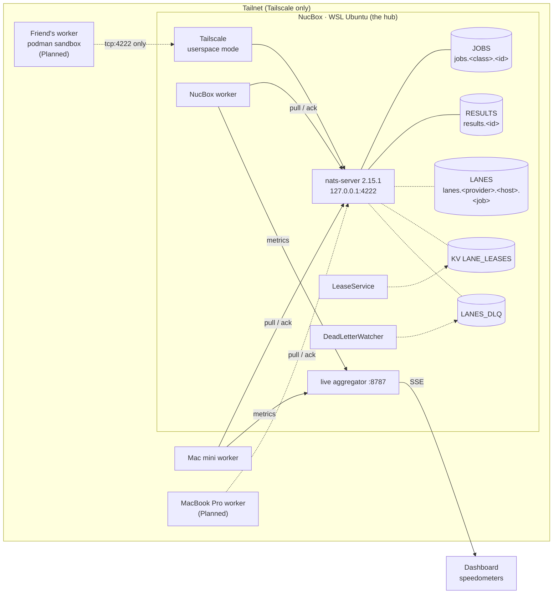
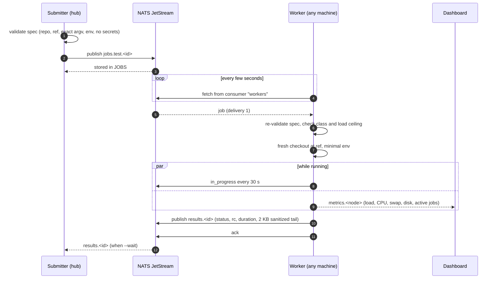
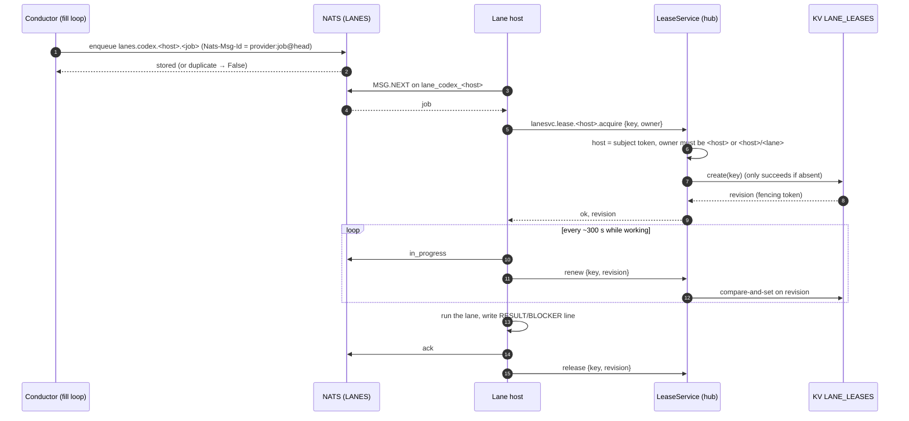
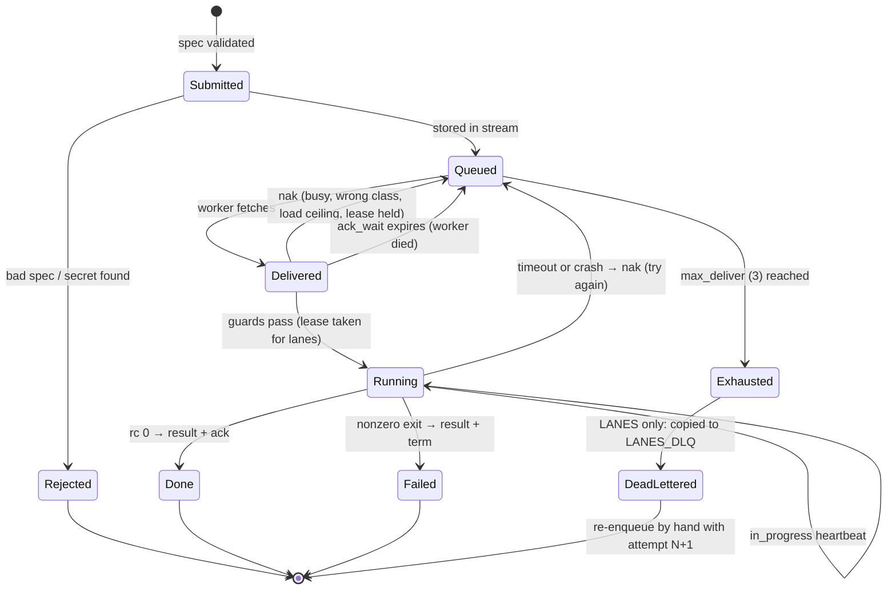
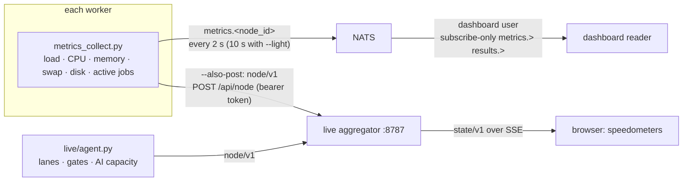

# StoryPool architecture

This is the technical tour: what runs where, how a job moves through the system, which NATS subjects and streams carry it, and how the speedometers get their numbers. Every name in backticks is taken from the code on `main` unless it is marked otherwise.

> **Status labels used here**
> - **Built**: running today.
> - **Merged, not live**: code and tests are on `main` (bob-ops-dashboard #71) but the hub has not been switched over yet.
> - **In progress**: in a draft PR (#68), not merged.
> - **Planned**: designed in these docs, not written yet.

## 1. Design goals

1. **Small and boring.** One queue server, one worker program, plain Python. Kubernetes, Ray and Temporal were considered and skipped for now: they solve problems a few home machines don't have yet.
2. **The server enforces the rules.** Concurrency caps, who-can-ack-what and who-can-write-what are NATS permissions and JetStream settings, not polite agreements between scripts.
3. **Never lose work, never double-book it.** Jobs are delivered at least once, and a lease makes sure only one machine acts on a given PR at a time.
4. **Safe for friends.** Guest machines get sandboxed jobs with no keys. Donor credentials never leave the donor's machine.
5. **Visible.** Every machine streams live metrics, so you can see at a glance who is busy and who is idle.

## 2. Components

| Component | Where | What it does | Code | Status |
|---|---|---|---|---|
| **nats-server** v2.15.1 + JetStream | WSL Ubuntu on the NucBox | The queue. Binds `127.0.0.1:4222`; monitoring on `127.0.0.1:8232` (8222 is taken by Vaultwarden). | `cluster/install-nats.sh`, `cluster/nats-up.sh`, `cluster/nats.conf.template` | Built |
| **Tailscale (userspace)** | WSL on the NucBox | Accepts tailnet connections to port 4222 and forwards them to localhost, so the server never listens on a real network interface. | (host setup) | Built |
| **Stream setup** | Hub | Creates `JOBS`, `RESULTS` and the `workers` consumer, idempotently. | `cluster/setup_streams.py` | Built |
| **Submitter** | Hub (operator credential) | Validates a job spec and publishes it. `nuc-verify-queue` turns a clean, pushed repo into a `test` job and falls back to SSH otherwise. | `cluster/submit.py`, `cluster/nuc-verify-queue`, `cluster/spec.py` | Built |
| **Worker** | Every machine | Pulls jobs, checks guards, runs the job in a fresh checkout with a minimal environment, publishes the result, and streams metrics. | `cluster/worker.py`, `cluster/worker_logic.py`, `cluster/job_exec.py`, `cluster/metrics_collect.py` | Built (Mini, NucBox) |
| **Lanes library** | Hub + lane hosts | AI-lane work queue with per-host consumers, leases, dedupe and a dead-letter queue. | `cluster/lanes.py`, `cluster/LANES.md` | Merged, not live |
| **Stage-2 permissions** | Hub config | The locked-down grants for operator, conductor and lane hosts, proven on a real server in tests. | `cluster/lanes_perms.py`, `cluster/tests/test_lanes_perms.py` | Merged, not live |
| **Live dashboard** | Aggregator on the NucBox, agents everywhere | Merges node metrics and GitHub state and serves the speedometer UI over SSE. | `live/aggregator.py`, `live/agent.py`, `live/web/index.html`, `live/speed_index.py` | Built |
| **Capability routing, enrollment, guest sandbox** | Hub + every worker | Capability heartbeats, routing to a node that reported the capability, single-use join codes, podman guests. | draft PR #68 | In progress |
| **Donor caps** | Friend's machine | Local caps on what a friend donates; reports headroom only. | [DONATIONS.md](DONATIONS.md) | Planned |

## 3. Subjects and streams

### Built today

| Subject | Stream | Retention | Who publishes | Who reads |
|---|---|---|---|---|
| `jobs.<class>.<id>` (`jobs.>`) | `JOBS` | Work queue, file storage, 24 h max age | Operator (the `nucbox` user) via `submit.py` | Durable pull consumer `workers` (explicit ack, `ack_wait` 30 min, `max_deliver` 3) |
| `results.<id>` | `RESULTS` | Limits, 7 days | The worker that ran the job | Submitter (`--wait`), dashboard |
| `metrics.<node_id>` | none (core NATS) | Not stored | Each worker, for its own node only | `dashboard` user (subscribe-only) |

Job classes and their exact allowed commands live in `cluster/config.py`:

| Class | Allowed argv (entire command, nothing added) |
|---|---|
| `test` | `python3 -m unittest discover -s cluster/tests -v`, `python3 -m unittest discover -v`, `npm test` |
| `build` | `npm run build` |
| `render` | `npm run render` |

### Merged, not live: the lanes layer

| Subject / bucket | Stream | Purpose |
|---|---|---|
| `lanes.<provider>.<host>.<job>` | `LANES` (work queue, 2 h duplicate window) | One AI-lane job for one provider on one host. |
| durable `lane_<provider>_<host>` | on `LANES` | One consumer per provider per host. `max_ack_pending` = that host's lane target, so the server enforces the cap. `ack_wait` 600 s, `max_deliver` 3. |
| `$KV.LANE_LEASES.<key>` | `KV_LANE_LEASES` (TTL 900 s) | The lease for a piece of work. Key = repo + PR or issue, e.g. `rupret007.webjam.pr.390`. |
| `lanesvc.lease.<host>.<op>` | none (request/reply) | The only way a host touches leases. `<op>` is `acquire`, `renew`, `release` or `holder`. |
| `lanes_dlq.<provider>.<host>` | `LANES_DLQ` (limits, 7 days) | Jobs that ran out of deliveries. |
| `$JS.EVENT.ADVISORY.CONSUMER.MAX_DELIVERIES.LANES.*` | none (server advisory) | Tells the `DeadLetterWatcher` that a job ran out of tries. |
| `_INBOX_<host>.>` | none | Each host's private reply inbox. |

`PROVIDERS` in `cluster/lanes.py` is an allowlist: `codex`, `cursor`, `gemini`, `claude`, `minimax`. Host names must match `^[a-z][a-z0-9-]{0,23}$`.

### In progress (draft PR #68, names may still change)

Capability routing adds a `CAPJOBS` stream with per-node durables `cap_<token>_n_<node>` on `cap.<token>.n.<node>.*`, and a `SANDBOX` stream with `guests_n_<node>` on `sandbox.jobs.<node>.*` for guest work. These filters don't overlap, so NATS can enforce that each node only pulls and acks its own deliveries.

## 4. Job lifecycle

### 4.1 The happy path (build and test jobs, built today)

### 4.2 Routing by capability

**Today (built):** each worker is started with `--classes` (for example `test,build`). A worker that receives a class it doesn't support naks it so another machine can take it.

**Next (in progress, draft PR #68):** each worker sends authenticated **capability heartbeats** describing what it can actually do (job classes, AI providers it has a lane for, sandbox support). The hub picks a free node from fresh heartbeats, routes the job to that node's own subject, and accepts the result only from that node. A newly joined machine gets exactly the capabilities it reports. There are no manual grants to remember. Friends' machines only ever advertise and receive sandboxed, no-key work.

### 4.3 AI lanes: lease, run, result (merged, not live)

If the lease is already held (usually a redelivery while the first lane is still running), `take()` **naks with a delay of one lease TTL** (900 s) instead of dropping the job or spinning on it.

### 4.4 Job states

How the worker decides (from `cluster/worker_logic.py` and `cluster/worker.py`):

| Situation | Action |
|---|---|
| Spec fails validation | `term` (never retried) |
| Class not in this worker's `--classes` | `nak` (another machine may take it) |
| 1-minute load above the job's `load_ceiling` | `nak` with 30 s delay |
| Worker already at `--max-parallel` | `nak` with 5 s delay |
| Exit code 0 | result `ok`, `ack` |
| Exit code > 0 | result `failed`, `term` (a real test failure, retrying won't help) |
| Timeout or negative exit code | result `timeout`/`error`, `nak` with 15 s delay |
| Third delivery would retry again | result `exhausted`, `term` |

### 4.5 Dead letters (LANES, merged, not live)

When a lane job hits `max_deliver`, the server emits a `MAX_DELIVERIES` advisory. The `DeadLetterWatcher` (operator side):

1. reads the stored job by its stream sequence;
2. **copies** it to `lanes_dlq.<provider>.<host>` with headers `Lanes-Orig-Seq`, `Lanes-Orig-Subject`, `Lanes-Consumer`, `Lanes-Deliveries` and an idempotent `Nats-Msg-Id`;
3. **waits for the server's publish confirmation**;
4. only then **deletes** the original from `LANES`.

A crash between steps can at worst leave a duplicate copy, never a lost job. `dead_letters()` lists the DLQ newest-first for the dashboard, and the conductor can re-enqueue a job with `attempt=N+1`.

`JOBS` (build/test) has no separate DLQ: after three deliveries the worker publishes an `exhausted` result and terms the job, so the failure is still visible in `RESULTS`.

## 5. Machine guards

Each machine protects itself before it takes work. These are the agreed limits:

| Machine | Guard | How it's applied |
|---|---|---|
| **Mac mini** | load under 10, swap under 80 %, at least 15 GB free disk | Job specs carry a `load_ceiling` that the worker checks (nak with delay if exceeded). Swap and free disk are reported in every metrics sample and are part of the guard policy for starting new lanes on the Mini. |
| **NucBox** | load under 12, 4–5 lanes | Same load-ceiling check. Lane count becomes the `max_ack_pending` of its lane consumers, which the server enforces. |
| **MacBook Pro** | Planned | Will report its own guards when it joins. |
| **Friends' machines** | Their own caps | Enforced locally by their worker before accepting a job. See [DONATIONS.md](DONATIONS.md). (Planned) |

## 6. AI lanes

AI work runs in **lanes**: one lane is one agent session working one PR or issue. Capacity is pooled across subscriptions, and each lane type has a job it's best at.

| Lane | Plan | Used for |
|---|---|---|
| **Codex** | $200 plan | General coding. **Low effort by default**; high effort only for security work, hard logic and fixes after a Karen fail. |
| **Cursor** | $200 plan | Composer lanes. |
| **Claude** | $20 plan | Key reviews and **Karen** (QA and security gate). |
| **MiniMax** | BYOK | Cheap lanes. |
| **Gemini** | Prepaid API | Reviews, for now. |

All paid lanes are prepaid, so cost is capped by design. The lanes queue lets the hub hand each host only as many lanes as its target allows, and the lease keeps two machines from ever working the same PR. Rollout follows the stages in `cluster/LANES.md`: library (done) → shadow → leases authoritative → dispatch from NATS → retire the file queue.

## 7. The metrics path

- **Who sends what.** A worker can only publish `metrics.<its own node>`, so one machine can't impersonate another on the speedometers.
- **Speed index.** Each speedometer shows a 0–100 score from `live/speed_index.py`: 30 % lines of code per minute (log scale, 500 = full), 20 % test runs per minute (6 = full), 20 % actions per minute (60 = full), 15 % CPU, 15 % active lanes (12 = full).
- **Access.** The aggregator refuses to start without a token file, binds privately, and is reached only over Tailscale or loopback. All outward strings pass through `live/sanitize.py`.
- **Donor shares (Planned).** Donor workers will add a small headroom record (donated, used, remaining, window open or closed) to their metrics. The dashboard shows it per donor; see [DONATIONS.md](DONATIONS.md#4-what-the-dashboard-shows).

## 8. Failure modes

| What breaks | What happens |
|---|---|
| A worker crashes mid-job | No `in_progress` and no ack, so after `ack_wait` the server redelivers to any capable worker. For lanes, the lease also expires after its TTL. |
| The hub is down | Workers keep retrying their fetch quietly (an empty or failed fetch isn't an error). `nuc-verify-queue` falls back to the original SSH path. |
| The same job is submitted twice | Lanes: `Nats-Msg-Id` dedupe within 2 h stores it once. |
| A lane's lease lapsed and someone else took it | The old lane's `renew`/`release` fail the compare-and-set, so it can't overwrite the new holder. |
| A job keeps failing | Build/test: `exhausted` result after 3 tries. Lanes: moved to `LANES_DLQ`. |
| Config drift on a lane consumer | `ensure_lanes` applies editable changes in place; a non-editable difference raises `LaneConfigConflict` instead of silently recreating and losing in-flight state. |

## 9. Why not Kubernetes, Ray or Temporal (yet)

| Tool | Why skipped for now |
|---|---|
| Kubernetes | Three mixed machines (macOS, Windows/WSL) don't need a scheduler of schedulers. The operational cost would outweigh the benefit. |
| Ray | Great for Python data and ML pipelines; StoryPool jobs are shell commands and agent sessions. |
| Temporal | Durable workflows are appealing, but JetStream's acks, redelivery, KV leases and a DLQ cover today's needs with one dependency. |

We'll revisit if the pool grows well past a handful of machines or jobs start needing multi-step workflows.

## 10. Where to look in the code

| You want to… | Read |
|---|---|
| Change what a job may run | `cluster/config.py`, `cluster/spec.py` |
| Change worker behavior | `cluster/worker.py`, `cluster/worker_logic.py` |
| Understand lanes, leases, DLQ | `cluster/lanes.py`, `cluster/LANES.md` |
| See the permission model | `cluster/nats.conf.template` (live), `cluster/lanes_perms.py` (stage 2) |
| Run the tests | `PYTHONPATH=. BOB_REQUIRE_NATS=1 python3 -m cluster.tests.run_strict` (what CI runs in `.github/workflows/cluster-tests.yml`) |
