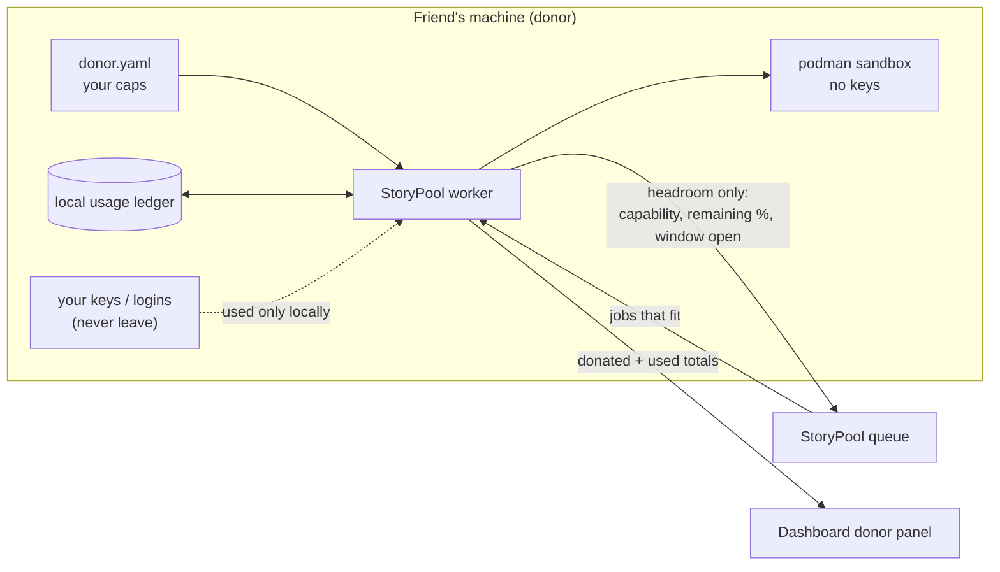
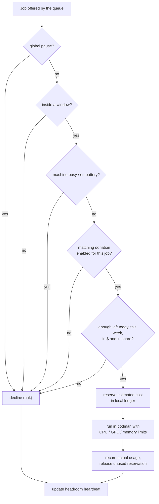

# Capped donations

> **Status: Planned.** Designed on 16 October 2026. Nothing on this page is built yet.

Friends who join the StoryPool can **donate** some of what they have: spare CPU or GPU time, a local model, or a slice of a pay-as-you-go API key. The core idea is simple:

> **You set the limits, on your own machine. Your worker enforces them before it accepts any job. Your credentials never leave your machine. The queue only learns how much headroom you have left.**

## Terms caveat (read this first)

**Personal AI subscriptions (Codex, Claude, ChatGPT and similar) are licensed to one person.** Using your personal subscription to run *other people's* jobs may violate the provider's terms of service, and could put your account at risk.

The safe donation types are:

| Donation type | Examples | Why it's fine |
|---|---|---|
| **Plain compute** | builds, tests, renders | It's your hardware. No third-party terms involved. |
| **Local models** | Ollama running on your machine | Runs locally under the model's own license. Check that license, but there's no per-person account. |
| **Pay-as-you-go API keys** | a prepaid or metered API key | Billed per use to you, under API terms that generally allow use in your own apps and services. Check your provider's terms. |

StoryPool's design **supports every type**, including subscription lanes, because the mechanism is the same. **The donor chooses.** The default config ships with subscription donations turned off, and the worker prints a terms reminder whenever a subscription lane is enabled. When in doubt, donate compute.

## 1. How it works



1. **You write your caps** in a local file. Nobody else can see or change it.
2. **Your worker keeps a local ledger** of what it has used against each cap.
3. **Before accepting any job**, the worker checks every relevant cap. If the job doesn't fit, it declines (naks) and the queue offers it to someone else.
4. **It advertises headroom, not secrets.** Capability heartbeats carry "what I can do" and "how much is left", e.g. `compute: 40% of today's 3 h left, window open`. Never a key, never a login, never your exact usage history.
5. **The dashboard** shows each donor's donated and used share, so everybody can see the pool is fair.

## 2. Donor config

The file lives on the donor's machine, for example `~/.config/storypool/donor.yaml` (mode 600). The path and field names below are a proposed schema.

```yaml
# ~/.config/storypool/donor.yaml : read only by your own StoryPool worker.
# Nothing in this file is ever sent to the queue. Only remaining headroom is.
version: 1
display_name: "Friend A"          # how you appear on the dashboard (optional)
timezone: "America/Chicago"       # windows below are in this zone

# Global limits that apply to everything you donate.
global:
  enabled: true
  pause: false                    # flip to true to stop accepting new jobs right away
  max_hours_per_day: 4
  max_hours_per_week: 20
  windows:                        # only accept jobs inside these windows
    - days: [mon, tue, wed, thu, fri]
      from: "22:00"
      to: "07:00"                 # crosses midnight: fine
    - days: [sat, sun]
      from: "00:00"
      to: "23:59"
  cpu_share: 0.25                 # at most 25% of your CPU cores
  gpu_share: 0.0                  # no GPU unless a donation below says so
  memory_gb: 4
  disk_gb: 10
  yield_when_busy:                # back off when you're using the machine
    load_above: 4.0
    on_battery: true
    user_active_minutes: 5

donations:
  # Plain compute: builds and tests in the podman sandbox. Safe.
  - type: compute
    enabled: true
    classes: [test, build]
    max_hours_per_day: 3
    cpu_share: 0.25

  # Local model via Ollama. Safe (check the model's license).
  - type: local_model
    enabled: true
    runtime: ollama
    models: ["llama3.1:8b"]
    gpu_share: 0.5
    max_hours_per_day: 2
    windows:
      - days: [sat, sun]
        from: "09:00"
        to: "21:00"

  # Pay-as-you-go API key. Generally fine; check your provider's terms.
  - type: api_key
    enabled: false
    provider: gemini
    credential_ref: "keychain:storypool-gemini"   # a pointer to YOUR keychain, never the key itself
    max_spend_usd_per_week: 5.00
    max_requests_per_day: 200

  # Personal subscription. OFF by default. See the terms caveat:
  # personal plans are licensed to one person.
  - type: subscription
    enabled: false
    provider: codex
    share_of_weekly_limit: 0.20   # "Codex: 20% of my weekly limit"
    max_hours_per_day: 3          # "max 3 h/day"
    windows:                      # "nights only"
      - days: [mon, tue, wed, thu, fri, sat, sun]
        from: "23:00"
        to: "06:00"
    acknowledge_terms: false      # must be set to true by you before this can turn on
```

### Field reference

| Field | Meaning |
|---|---|
| `global.pause` | Kill switch. Stops new jobs at once; running jobs finish (or are stopped if `max_hours_per_day` is hit). |
| `max_hours_per_day` / `max_hours_per_week` | Wall-clock hours of donated work, measured locally. |
| `windows` | Days and local times when jobs may *start*. A window that crosses midnight is fine. |
| `cpu_share`, `gpu_share`, `memory_gb`, `disk_gb` | Hard limits applied to the sandbox (podman CPU, memory and storage limits). |
| `yield_when_busy` | Your machine comes first: decline new work when you're busy or on battery. |
| `classes` | Which job classes you'll take (`test`, `build`, `render`). |
| `share_of_weekly_limit` | For providers with a weekly allowance: the fraction you're willing to give, measured against what your own worker has used. |
| `max_spend_usd_per_week` | For pay-as-you-go keys: a dollar cap tracked by your worker. |
| `credential_ref` | Where *your* worker finds the credential (keychain or a local file). The value is a pointer, never the secret. |
| `acknowledge_terms` | Required `true` before any `subscription` donation can be enabled. |

## 3. How caps are enforced

Enforcement happens **on the donor's machine, before a job is accepted.** The queue never has to be trusted to respect your limits.



Details:

- **Reserve, then settle.** Before starting, the worker reserves the job's estimated cost (its timeout, or an estimate for API calls) in the ledger, so two jobs can't both squeeze into the last bit of budget. After the job it records actual usage and releases the rest.
- **Hard stops.** If a running job would cross `max_hours_per_day` or the window closes, the worker stops it, reports a clean "cap reached" result, and the job goes back to the queue for someone else.
- **Shares of a weekly limit** are measured against the donor's own local ledger: the worker counts what it used on behalf of StoryPool. It never needs to log into a provider's account page.
- **Sandboxed and keyless.** Compute and local-model jobs run in podman with no keys. For an `api_key` donation, the worker makes the API call itself on the donor's side and returns only the result; the key is never placed in the job or the sandbox.
- **Fail closed.** If the config is missing, unreadable or invalid, the worker donates nothing.

## 4. What the dashboard shows


*Mockup with illustrative numbers. The speedometers exist today; the donor panel is Planned.*

Per donor, the panel shows:

| Column | Source |
|---|---|
| Donor | `display_name` (or an anonymous label) |
| Type | compute, local model, API key, subscription |
| Cap | a human summary of the active caps (e.g. "25% CPU · 3 h/day") |
| Donated · used | two bars: how much headroom was offered this period, and how much StoryPool actually used |
| Window | when the donor accepts work |
| Status | accepting, outside window, paused, near cap, cap reached |

What it never shows: keys, account names, provider dashboards, raw usage logs, IPs or host names.

## 5. What the queue sees

A donor's heartbeat is deliberately thin. Illustrative shape:

```json
{
  "node": "friend-a",
  "donor": true,
  "capabilities": ["sandbox", "test", "build", "local_model"],
  "headroom": {
    "compute":     {"remaining_pct": 40, "window_open": true},
    "local_model": {"remaining_pct": 100, "window_open": false}
  },
  "period": {"donated_h": 21.0, "used_h": 11.8}
}
```

That's enough to route a job sensibly and draw the dashboard. Nothing else leaves the donor's machine.

## 6. Open questions

- How to estimate the cost of an API job before running it (token budget per job class?).
- Whether donors want weekly reports by message.
- Whether "near cap" should lower a donor's routing priority before the cap is actually hit.
