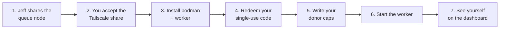

# Joining the StoryPool

Welcome! This page walks a friend through joining, step by step. It also covers adding one of Jeff's own machines.

> **Status.** Jeff's own machines join today using the manual steps in `cluster/README.md`. **Friend joining is Planned**: it depends on single-use enrollment and the podman guest sandbox (draft PR #68) and on refusing the reserved names `hub` and `conductor` (in progress). Steps marked **Planned** don't work yet.

## What you're agreeing to (the friendly version)

- Your machine will run **sandboxed jobs with no keys**: builds, tests, and maybe local-model work if you offer it.
- **You set the limits** (hours, time windows, CPU/GPU share) in a file on your own machine, and you can pause any time.
- **Your keys and logins never leave your machine.** If you donate an API key, your worker uses it locally and the queue only sees how much headroom is left.
- Your machine can reach **one port on one machine** (the queue, tcp:4222) and nothing else on Jeff's network.
- Please read the **[terms caveat](DONATIONS.md#terms-caveat-read-this-first)**: don't donate a personal AI subscription unless you're sure your provider allows it. Compute and local models are always fine.

## Before you start

| You need | Notes |
|---|---|
| A Mac, Linux box, or Windows with WSL | Any reasonably modern machine. |
| Tailscale | Free personal plan is fine. |
| podman | Rootless mode. Used for the guest sandbox. |
| Python 3.11+ | For the worker. |
| An invite from Jeff | A single-use join code, sent privately. |

## Step by step



### 1. Jeff shares the queue with you · Planned

Jeff shares the queue node with you from the Tailscale admin console and adds you to the friends group whose ACL allows **only tcp:4222** to the queue (see [SECURITY.md](SECURITY.md#4-network-tailscale-only)).

### 2. Accept the Tailscale share · Planned

Accept the share invite in Tailscale. The queue shows up as one shared machine. You won't see any of Jeff's other devices.

Quick check (the address comes from your Tailscale app; don't post it anywhere):

```bash
nc -vz <queue-address-from-tailscale> 4222   # should connect
nc -vz <queue-address-from-tailscale> 22     # should be refused
```

### 3. Install podman and the worker · Planned

```bash
# macOS
brew install podman python@3.12
podman machine init && podman machine start

# Debian/Ubuntu (or WSL)
sudo apt install podman python3 python3-venv
```

Then get the worker at the exact commit Jeff gives you. In draft PR #68 this is a one-line installer that checks a SHA-256 checksum of the pinned commit before unpacking, and refuses an unpinned ref or a checksum mismatch.

### 4. Redeem your single-use join code · Planned

The installer asks for your code **without echoing it** (it is never put on the command line, in `ps`, or in shell history). Redeeming it:

- creates your own NATS credential, stored only on your machine (mode 600);
- registers your host name. Pick something simple like `friend-alex`. **`hub` and `conductor` are reserved and will be refused**;
- gives your user guest-only permissions: your own sandbox subjects, your own inbox, nothing else.

Codes are single use and rate-limited. If something goes wrong, ask Jeff for a fresh one.

### 5. Write your donor caps · Planned

Create `~/.config/storypool/donor.yaml` (mode 600). Start small. The safest first config is compute only, nights only:

```yaml
version: 1
display_name: "Alex"
timezone: "America/Chicago"
global:
  enabled: true
  pause: false
  max_hours_per_day: 2
  windows:
    - days: [mon, tue, wed, thu, fri, sat, sun]
      from: "23:00"
      to: "06:00"
  cpu_share: 0.25
  memory_gb: 4
  disk_gb: 10
donations:
  - type: compute
    enabled: true
    classes: [test, build]
```

The full schema, including local models and API keys, is in [DONATIONS.md](DONATIONS.md#2-donor-config).

### 6. Start the worker · Planned

The worker reads your caps, starts advertising your capabilities and remaining headroom, and begins accepting jobs that fit. To stop donating instantly, set `pause: true` (or just stop the worker). Running jobs are stopped cleanly and handed back to the queue.

### 7. See yourself on the dashboard · Planned

Jeff's dashboard shows your machine and your **donated vs used** share. It never shows your keys, account names or address.

## Leaving

Stop the worker, delete `~/.config/storypool/`, and leave the Tailscale share. Tell Jeff so he can revoke your credential. Revocation reloads the server config and confirms your connection is dropped. That's it, no hard feelings.

## Adding one of Jeff's own machines (Built)

This is how the Mini and NucBox joined, and how the MacBook Pro will. Full details are in `cluster/README.md`.

1. On the hub (once): install and start NATS (`cluster/install-nats.sh`, `cluster/nats-up.sh start`), then run `cluster/setup_streams.py` with the operator credential.
2. Copy **only that machine's** token line from the hub's `tokens.env` to the new machine (`chmod 600`).
3. `pip install -r cluster/requirements.txt`
4. Point the worker at the queue (`BOB_NATS_URL` or `~/.config/bob-cluster/nats-url`) and start it, for example:

   ```bash
   python3 cluster/worker.py --node-id mini --classes test,build --max-parallel 2 --light
   ```

5. Optional: add `--also-post <aggregator-url>/api/node` to feed the live dashboard directly.

With capability routing (in progress), step 4 becomes simpler: the machine reports what it can do and gets matching work automatically, no manual grants.

## Troubleshooting

| Symptom | Likely cause |
|---|---|
| Can't connect to 4222 | Share not accepted, Tailscale not running, or the ACL hasn't been applied yet. |
| Connected but no jobs | Outside your window, paused, machine busy, or no queued jobs match your capabilities. That's normal. |
| "name reserved" on enrollment | You picked `hub` or `conductor`. Choose another name. |
| Worker exits saying config invalid | Fix `donor.yaml`. The worker fails closed and donates nothing until it's valid. |
