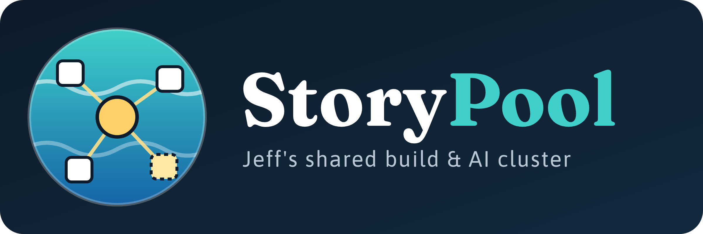
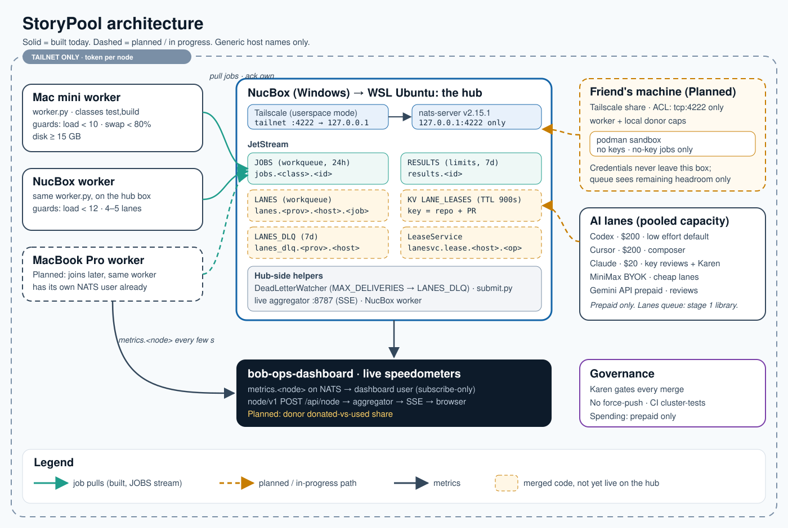
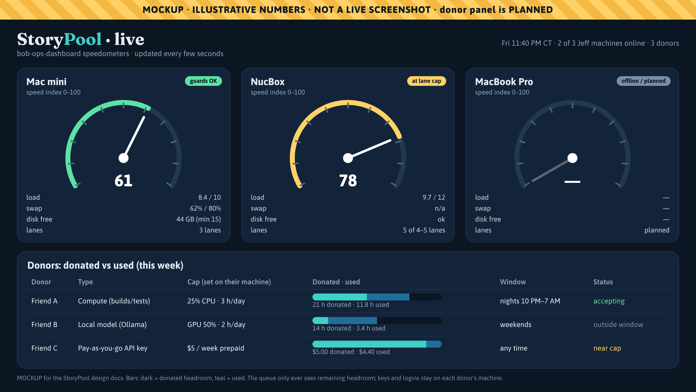

  

# StoryPool

**StoryPool is Jeff Story's shared build and AI cluster.** A handful of everyday machines (a Mac mini, a Windows NucBox, and later a MacBook Pro) pull work from one job queue, run it, report back, and show their speed live on a dashboard. Friends can *join the StoryPool* too: they lend some spare compute, or a capped slice of a pay-as-you-go AI key, on terms they set on their own machine.

It is deliberately small. No Kubernetes, no Ray, no Temporal. Just a NATS JetStream queue, one identical worker per machine, Tailscale for the network, and a lot of tests.

> **Status at a glance.** The queue, the workers and the live dashboard run today. The lanes library and its locked-down permission model are merged but not yet switched on at the hub. Capability routing and guest sandboxes are in a draft PR. Friend joining and capped donations are **Planned**. See [ROADMAP.md](ROADMAP.md) for the exact split.

## What it does, in one picture

1. **Someone submits a job** (run the tests, do a build, have an AI lane review a PR).
2. **The queue holds it** on the NucBox hub until a machine that can do it asks for work.
3. **A worker pulls it**, checks its own guards (is the machine too busy? low on disk?), and runs it.
4. **The result goes back** to the queue, and the worker streams live metrics to the dashboard the whole time.
5. **If a job keeps failing**, it is parked in a dead-letter queue instead of looping forever.

## Who it's for

| You are… | Start here |
|---|---|
| **Jeff** | This page, then [ROADMAP.md](ROADMAP.md) for what's next and [DONATIONS.md](DONATIONS.md) for tonight's new idea. |
| **A contributor** | [ARCHITECTURE.md](ARCHITECTURE.md) (subjects, streams, job lifecycle), then [SECURITY.md](SECURITY.md). The code lives in [`cluster/`](../../cluster) and [`live/`](../../live). |
| **A friend thinking about joining** | [JOINING.md](JOINING.md) and [DONATIONS.md](DONATIONS.md). Short version: you stay in control, your keys never leave your machine, and guest jobs run in a sandbox with no keys at all. |

## The pieces

| Piece | What it is | Status |
|---|---|---|
| **Queue** | `nats-server` v2.15.1 with JetStream, in WSL Ubuntu on the NucBox. Listens on `127.0.0.1` only; Tailscale (userspace mode) forwards tailnet traffic to it. | Built |
| **Workers** | One identical `cluster/worker.py` per machine. Pulls jobs, runs them in a clean checkout, publishes results and metrics. | Built (Mini, NucBox). MacBook Pro: Planned |
| **Dashboard** | `bob-ops-dashboard` live view: per-machine speedometers fed by worker metrics. | Built. Donor panel: Planned |
| **AI lanes** | Pooled subscription capacity: Codex, Cursor, Claude, MiniMax (BYOK) and Gemini (prepaid API). | Lanes queue merged as a library (stage 1); not live yet |
| **Access** | Tailscale only, with one NATS credential per machine. | Built |
| **Routing by capability** | Each machine reports what it can do; jobs go to a machine that reported that capability. No manual grants. | In progress (draft PR #68) |
| **Friends + donations** | Join over a Tailscale share; sandboxed, no-key jobs only; caps enforced on the friend's own machine. | Planned |

## What the dashboard will look like with donors

*Mockup with made-up numbers. The speedometers exist today; the donor panel is Planned.*

## House rules

- **Karen gates every merge.** Karen is the QA and security agent; nothing lands without a pass.
- **No force-push.** History stays honest.
- **Prepaid spending only.** Every paid AI lane runs on a prepaid plan or prepaid credit, so a runaway job can't run up a bill.
- **No secrets in jobs.** Job specs are checked for anything that looks like a key, and rejected if they contain one.

## The docs

| Doc | What's inside |
|---|---|
| [ARCHITECTURE.md](ARCHITECTURE.md) | Components, data flow, job lifecycle, subjects and streams, the metrics path. |
| [SECURITY.md](SECURITY.md) | Threat model, permission matrix, Tailscale ACL, podman sandbox, secrets policy, known follow-ups. |
| [DONATIONS.md](DONATIONS.md) | Capped donations: donor config, local enforcement, reporting, and the terms caveat. |
| [JOINING.md](JOINING.md) | How a friend joins, step by step. |
| [ROADMAP.md](ROADMAP.md) | Built, in progress, planned. |

Why "StoryPool"? It's Jeff's pool of machines (and friends) that everybody's work can swim in. Jeff named it on 16 October 2026.
