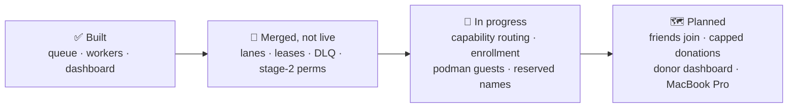

# StoryPool roadmap

Last updated 16 October 2026. Status is honest: **Built** means running, **Merged, not live** means on `main` but not switched on, **In progress** means a draft PR or active work, **Planned** means designed only.

## ✅ Built

| Item | Where |
|---|---|
| NATS JetStream queue (nats-server v2.15.1) in WSL Ubuntu on the NucBox, loopback-only, reached over userspace Tailscale | `cluster/install-nats.sh`, `cluster/nats-up.sh`, `cluster/nats.conf.template` |
| `JOBS` (work queue) and `RESULTS` streams, `workers` pull consumer | `cluster/setup_streams.py` |
| Job spec v1 with exact argv allowlists, repo allowlist, env allowlist, secret scanning | `cluster/spec.py`, `cluster/config.py` |
| Identical worker on the Mac mini and the NucBox: guards, clean checkouts, sanitized results, in-progress heartbeats | `cluster/worker.py`, `cluster/worker_logic.py`, `cluster/job_exec.py` |
| Per-node credentials; dashboard user subscribe-only | `cluster/nats.conf.template` |
| `nuc-verify` over the queue with SSH fallback | `cluster/nuc-verify-queue` |
| Live speedometer dashboard (node metrics + GitHub state over SSE) | `live/` |
| Strict cluster CI: fails on skipped or missing required tests | `.github/workflows/cluster-tests.yml`, `cluster/tests/run_strict.py` |
| Governance: Karen gates every merge, no force-push, prepaid spending only | process |

## 🧩 Merged, not live

| Item | Where | Next step |
|---|---|---|
| Lanes work queue `LANES` with one consumer per provider per host and server-enforced lane caps | `cluster/lanes.py` (#71) | Shadow mode (LANES.md stage 2) |
| Leases in KV `LANE_LEASES` with fencing tokens, served only by `LeaseService` | `cluster/lanes.py` (#71) | Run the service on the hub |
| Dead-letter queue `LANES_DLQ` (copy → confirm → delete) | `cluster/lanes.py` (#71) | Run `DeadLetterWatcher`; show DLQ on dashboard |
| Stage-2 permission model (Karen-passed) | `cluster/lanes_perms.py`, `cluster/tests/test_lanes_perms.py` (#71) | Apply to the live hub config (needs Jeff) |

## 🚧 In progress

| Item | Where |
|---|---|
| Capability heartbeats and routing by reported capability (no manual grants) | draft PR #68 |
| Single-use enrollment codes, pinned + checksummed installer, confirmed revoke | draft PR #68 |
| Guest jobs in rootless podman with no keys; per-node `SANDBOX` subjects | draft PR #68 |
| **Refuse reserved host names `hub` and `conductor`** (blocker for friends) | in progress |
| Gemini lanes on the board | draft PR #70 |

## 🗺️ Planned

| Item | Doc |
|---|---|
| MacBook Pro joins as the third worker | [JOINING.md](JOINING.md) |
| Friends join via Tailscale share, ACL tcp:4222 only | [JOINING.md](JOINING.md), [SECURITY.md](SECURITY.md) |
| Capped donations: local `donor.yaml`, local enforcement, headroom-only reporting | [DONATIONS.md](DONATIONS.md) |
| Dashboard donor panel: donated vs used per donor | [DONATIONS.md](DONATIONS.md#4-what-the-dashboard-shows) |
| LANES stages 3–5: leases authoritative → dispatch from NATS → retire file queue | `cluster/LANES.md` |

## Known follow-ups

| Item | Status |
|---|---|
| Reserved names `hub` / `conductor` refused before any friend joins | In progress |
| Lease metadata readable by any host (`holder`) | Open |
| A delay-nak'd job holds its lane slot for the delay (nats-server 2.15.1) | Known, documented |
| Verify the lease service's reply path can't write `$KV.LANE_LEASES` | **Closed (HIGH)** — fixed by #76 (c838b310) |

## Not now (on purpose)

Kubernetes, Ray and Temporal. See [ARCHITECTURE.md](ARCHITECTURE.md#9-why-not-kubernetes-ray-or-temporal-yet).

## Gate to let friends in

All of these must be true:

- [ ] Reserved host names refused at enrollment
- [ ] Stage-2 style per-host permissions live on the hub (members and guests)
- [ ] Guest podman sandbox merged and Karen-passed
- [ ] Tailscale ACL for friends applied and tested (tcp:4222 only)
- [ ] Donor caps enforced locally, fail-closed, with tests
- [ ] Terms caveat shown in the worker when a subscription donation is enabled
